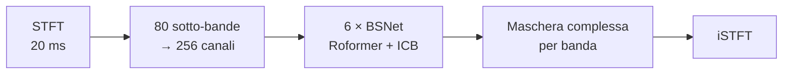
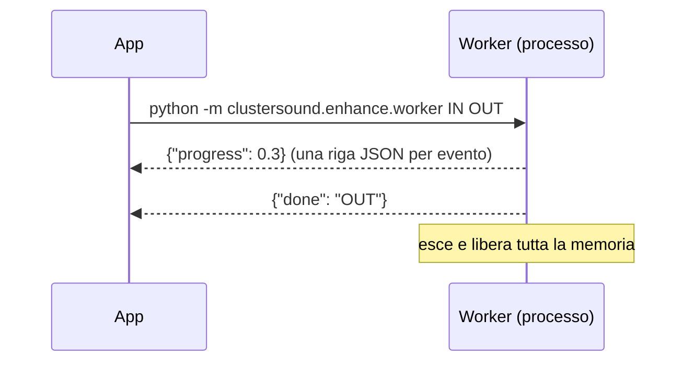

# Apollo (Migliora)

[Apollo](https://github.com/JusperLee/Apollo) (Kai Li, Yi Luo, 2024; licenza **CC BY-SA 4.0**) è una rete per il
**restauro di musica compressa**: ricostruisce le alte frequenze tagliate dai codec e attenua gli artefatti di MP3 e
streaming. Circa **16,6 M parametri**, 66 MB di pesi.

## Architettura (`enhance/apollo_net.py`)

Apollo lavora nel dominio tempo-frequenza con un approccio **band-split**:

1. **STFT** a 44,1 kHz con finestra di 20 ms (882 campioni, hop 441).
2. **Band split**: lo spettro è diviso in 80 sotto-bande; per ognuna parte reale/immaginaria normalizzate e
   log-potenza passano da RMSNorm e da una Conv1d verso 256 canali.
3. **6 blocchi BSNet**, ciascuno con:
    - un **Roformer** non causale *tra le bande* (attenzione con RoPE, 8 teste, finestra 100, MLP con gate SiLU),
      che modella le relazioni tra regioni dello spettro (come ricostruire le alte dalle basse);
    - un **ICB** *lungo il tempo*: 3 blocchi residui con conv depthwise k=7, RMSNorm, 1×1 con espansione ×4, SiLU.
4. Per ogni banda RMSNorm → Conv → GLU producono una **maschera/stima complessa**; l'iSTFT ricostruisce l'audio.

Il codice è un adattamento autonomo dell'originale: il checkpoint viene caricato con
`torch.load(weights_only=True)` e degli stub inerti per le classi di configurazione serializzate, senza eseguire
codice arbitrario dal file.

## Esecuzione isolata

- `runner.py` lancia un **processo separato** (l'app congelata rilancia sé stessa con `--enhance-worker`) e legge
  JSON riga per riga da stdout: `progress`, `done`, `error`. *Annulla* termina il processo (kill dopo 5 s) e
  cancella il file parziale.
- L'app **non importa mai PyTorch**: la memoria del modello (~1,6 GB di picco) torna al sistema a fine lavoro.

## Elaborazione (`enhance/worker.py`)

| Aspetto | Scelta |
|---|---|
| Ricampionamento | a 44,1 kHz con soxr VHQ |
| Blocchi | **2 s**, con **0,5 s** di contesto per lato (scartato) e **50 ms** di dissolvenza lineare |
| Canali | uno alla volta (memoria dimezzata) |
| Memoria GPU | cache di MPS/CUDA svuotata dopo ogni blocco |
| Fallback | se un'operazione fallisce sulla GPU, il resto del lavoro va su CPU |
| Uscita | frequenza = max(sorgente, 44,1 kHz); picchi oltre 0,999 scalati (niente clipping); WAV 24 bit |

Il risultato è un nuovo file `… (migliorato).wav` accanto ai sample, con la stessa nota di licenza o provenienza.

## Costi misurati

Apple Silicon (MPS), 30 s di audio stereo:

| | |
|---|---|
| Disco | 66 MB di pesi |
| RAM, solo durante il lavoro | ~1,6 GB di picco |
| Tempo | ~13 s, di cui ~2 s per caricare il modello |
