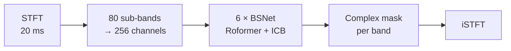
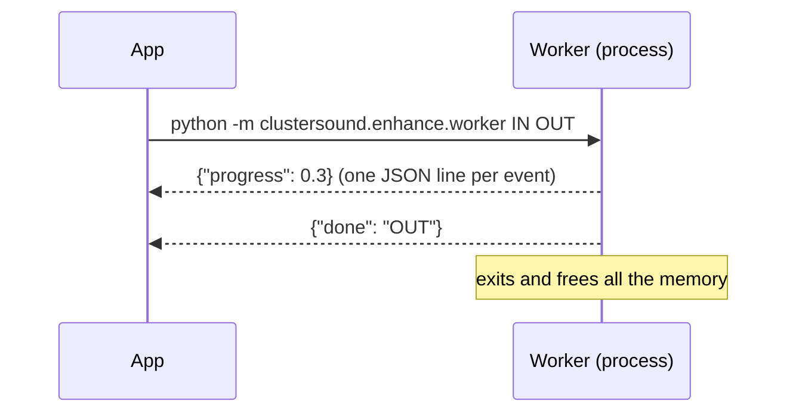

# Apollo (Enhance)

[Apollo](https://github.com/JusperLee/Apollo) (Kai Li, Yi Luo, 2024; **CC BY-SA 4.0** licence) is a network for the
**restoration of compressed music**: it rebuilds the high frequencies cut by the codecs and softens the artefacts of
MP3 and streaming. About **16.6 M parameters**, 66 MB of weights.

## Architecture (`enhance/apollo_net.py`)

Apollo works in the time-frequency domain with a **band-split** approach:

1. **STFT** at 44.1 kHz with a 20 ms window (882 samples, hop 441).
2. **Band split**: the spectrum is split into 80 sub-bands; for each one the normalised real/imaginary parts and the
   log-power go through RMSNorm and a Conv1d to 256 channels.
3. **6 BSNet blocks**, each with:
    - a non-causal **Roformer** *across the bands* (attention with RoPE, 8 heads, window 100, MLP with SiLU gate),
      which models the relations between regions of the spectrum (how to rebuild the highs from the lows);
    - an **ICB** *along time*: 3 residual blocks with depthwise conv k=7, RMSNorm, 1×1 with ×4 expansion, SiLU.
4. For every band RMSNorm → Conv → GLU produce a **complex mask/estimate**; the iSTFT rebuilds the audio.

The code is a self-contained adaptation of the original: the checkpoint is loaded with
`torch.load(weights_only=True)` and inert stubs for the serialised configuration classes, without running
arbitrary code from the file.

## Isolated execution

- `runner.py` launches a **separate process** (the frozen app launches itself again with `--enhance-worker`) and
  reads JSON line by line from stdout: `progress`, `done`, `error`. *Cancel* ends the process (kill after 5 s) and
  deletes the partial file.
- The app **never imports PyTorch**: the memory of the model (~1.6 GB peak) goes back to the system when the job
  ends.

## Processing (`enhance/worker.py`)

| Aspect | Choice |
|---|---|
| Resampling | to 44.1 kHz with soxr VHQ |
| Blocks | **2 s**, with **0.5 s** of context per side (discarded) and a **50 ms** linear crossfade |
| Channels | one at a time (half the memory) |
| GPU memory | MPS/CUDA cache emptied after every block |
| Fallback | if an operation fails on the GPU, the rest of the job goes to the CPU |
| Output | sample rate = max(source, 44.1 kHz); peaks above 0.999 scaled down (no clipping); 24-bit WAV |

The result is a new `… (enhanced).wav` file next to the samples (`… (migliorato).wav` with the Italian interface),
with the same licence or provenance note.

## Measured costs

Apple Silicon (MPS), 30 s of stereo audio:

| | |
|---|---|
| Disk | 66 MB of weights |
| RAM, only during the job | ~1.6 GB peak |
| Time | ~13 s, of which ~2 s to load the model |
