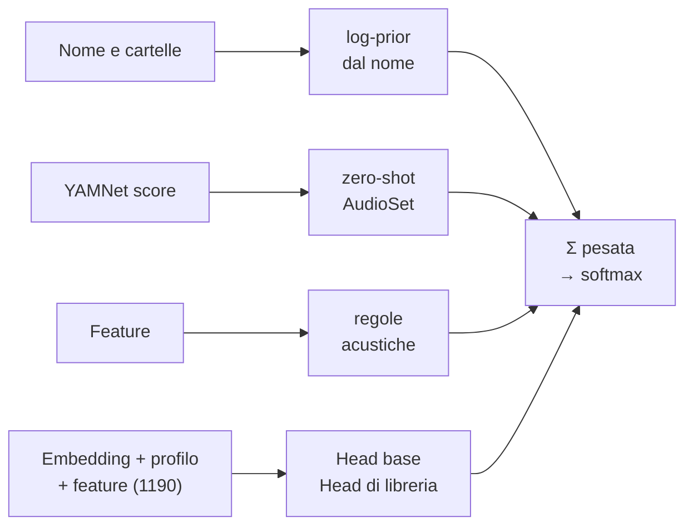

# Classificatore

Il classificatore (`classifier.py`) assegna ogni sample a una delle [34 classi](../reference/classes.md). Non è un
singolo modello ma la **fusione di quattro segnali** indipendenti, due dei quali sono reti neurali (MLP) che
lavorano sopra l'embedding di [YAMNet](yamnet.md).

## Architettura delle head

Entrambe le head sono un **MLP a un livello nascosto**:

\[
\mathbf{x} = [\,\hat{\mathbf{e}}_{1024}\;;\;\mathbf{m}_{144}\;;\;\mathbf{f}_{22}\,] \in \mathbb{R}^{1190}
\qquad
\mathbf{p} = \operatorname{softmax}\!\Big(W_2\,\operatorname{ReLU}\big(W_1\,\tfrac{\mathbf{x}-\mu}{\sigma} + b_1\big) + b_2\Big)
\]

- \(\hat{\mathbf{e}}\): embedding YAMNet normalizzato L2; \(\mathbf{m}\): profilo mel (spettro d'attacco, del corpo,
  inviluppo); \(\mathbf{f}\): le 22 [feature acustiche](../algorithms/audio-analysis.md) (con `log1p` sulle code).
- Strato nascosto da **256** unità ReLU; standardizzazione con media e deviazione del training set.
- Pesi \(W_1, W_2\) salvati in float16.

**Training** (`train_head`), in numpy puro:

| Iperparametro | Head di libreria | Head base |
|---|---|---|
| Ottimizzatore | Adam (β 0,9 / 0,999) | idem |
| Passi × batch | 1500 × 256 | 4000 × 256 |
| Learning rate | 3·10⁻³, decadimento lineare nella seconda metà | idem |
| Regolarizzazione | weight decay 10⁻³, dropout 0,2 | idem |
| Campionamento | bilanciato per classe (prob. ∝ peso / numerosità della classe) | idem |
| Classi minime | ≥ 4 esempi per classe, almeno 2 classi | ≥ 8 esempi |
| Inizializzazione | He (\(\mathcal{N}(0, 2/d)\)) | idem |

Il campionamento bilanciato rende il costo indipendente dalla dimensione della libreria: 1500 passi richiedono pochi
secondi anche con decine di migliaia di file.

### Head base

Inclusa nell'app (`models/base_head.npz`, 0,6 MB, 34 classi), addestrata con `tools/train_base_head.py` su circa
**27.000 sample** etichettati: un file diventa esempio solo se il suo nome contiene **una sola** keyword forte
(punteggio ≥ 0,75), con al massimo 4000 esempi per classe. Garantisce una buona classificazione anche in una
libreria senza nomi parlanti. Se la tassonomia cambia, l'app rifiuta di caricare una head incompatibile.

### Head di libreria (self-training)

Riaddestrata a **ogni classificazione** sulla libreria aperta. Gli esempi sono:

- i file il cui **nome** (non le cartelle) dà una keyword con punteggio ≥ 0,75 — peso 1;
- le **correzioni manuali** dell'utente — peso 3.

È il cuore dell'approccio: in una libreria reale molti file hanno nomi chiari (`Kick 04.wav`) e altri no
(`A101.wav`, `sample_23.wav`). La head impara come *suonano* i kick e gli snare **di quella libreria** dai file con
nome e li riconosce in quelli anonimi. Correggere un sample aggiunge un esempio pesante e fa ripartire il training
in background: le altre classificazioni si aggiornano in pochi secondi.

### Uscita delle head

Ogni head produce un'evidenza additiva limitata, così nessuna può da sola annullare gli altri segnali:

\[
h_c = \operatorname{clip}\big(\log(p_c \cdot k),\,-3,\,2\big) \quad\text{per le classi addestrate}, \qquad h_c = 0 \text{ altrimenti}
\]

dove \(k\) è il numero di classi della head (\(p_c \cdot k = 1\) è "nessuna preferenza").

## Gli altri segnali

**Nome e cartelle.** Il tokenizer spezza il percorso su separatori, camelCase e confini lettera/cifra; le keyword
della tassonomia danno un punteggio per classe (1,0, o meno per i token ambigui come `cl`, `op`). Il nome del file
pesa 1, le cartelle 0,65 · 0,45 · 0,3 · 0,2 salendo. Il log-prior è

\[
p_c = \frac{0{,}15}{K} + 0{,}85\,\frac{v_c^2}{\sum v^2},\qquad
n_c = \big(\log p_c - \log\tfrac{1}{K}\big)\cdot\max v
\]

quindi un'evidenza debole (solo una cartella) spinge meno. Regole speciali gestiscono "open hat" vs "hat", "808"
accanto a un altro nome di tamburo, le parole generiche da FX.

**Zero-shot YAMNet.** \(s = 0{,}5\,s_{\max} + 0{,}5\,s_{\text{mean}}\) sui 521 score AudioSet; per ogni classe il
massimo di \(s_i \cdot w_{i,c}\) sulle classi AudioSet mappate (es. Clap ← *Clapping* 1,0, *Applause* 0,6), poi
\(\log(x + 0{,}02)\).

**Regole acustiche.** Priori additivi a forma di sigmoide calcolati dalle feature: energia in basso (kick, 808,
tom vs bass), decadimento e T60 (closed vs open hat, crash, coda tonale dell'808), durata (click brevissimi, pad e
texture lunghe), tonalità vs rumore, direzione dello sweep (riser vs downlifter). Dettagli in
[Algoritmi › Classificazione](../algorithms/classification.md).

## Fusione e decisione

\[
\mathbf{P} = \operatorname{softmax}\big(2{,}0\,\mathbf{n} + 0{,}25\,\mathbf{a} + 0{,}25\,\mathbf{r} + 2{,}0\,\mathbf{h}_{\text{lib}} + 1{,}5\,\mathbf{h}_{\text{base}}\big)
\]

Senza alcuna head (caso limite) i pesi diventano \(2{,}0\,\mathbf{n} + 1{,}0\,\mathbf{a} + 0{,}8\,\mathbf{r}\). I pesi sono
stati tarati con `tools/evaluate.py`.

- La **classe** è l'argmax se \(P \ge 0{,}22\), altrimenti *Unsorted*.
- Le prime 4 classi sono salvate come **alternative** (mostrate nella tendina).
- Un'**etichetta manuale** vince sempre (confidenza 1,0).

## Accuratezza

`tools/evaluate.py` nasconde nome e cartelle dei file (validazione incrociata a 5 fold) e confronta la classe
prevista con quella indicata dal nome. Libreria di test: 4.932 file, 2.845 etichettati; la head base è stata
addestrata su **altri** ~22.000 sample (duplicati esclusi).

| Scenario | Tutti | Solo one-shot |
|---|---|---|
| File senza nome, ma la libreria contiene altri file con nomi (caso tipico) | 72% | 77% |
| Nessun nome in tutta la libreria (solo audio + head base) | 57% | 65% |
| Solo YAMNet zero-shot + regole, senza head (riferimento) | 16% | — |

I file con un nome parlante vengono classificati quasi sempre in base al nome. Gli errori residui sono confusioni
tra classi vicine (snare/clap/rimshot, closed/open hat, bass/synth) e rumore delle etichette (es. "snare roll" dentro
un fill di batteria).
