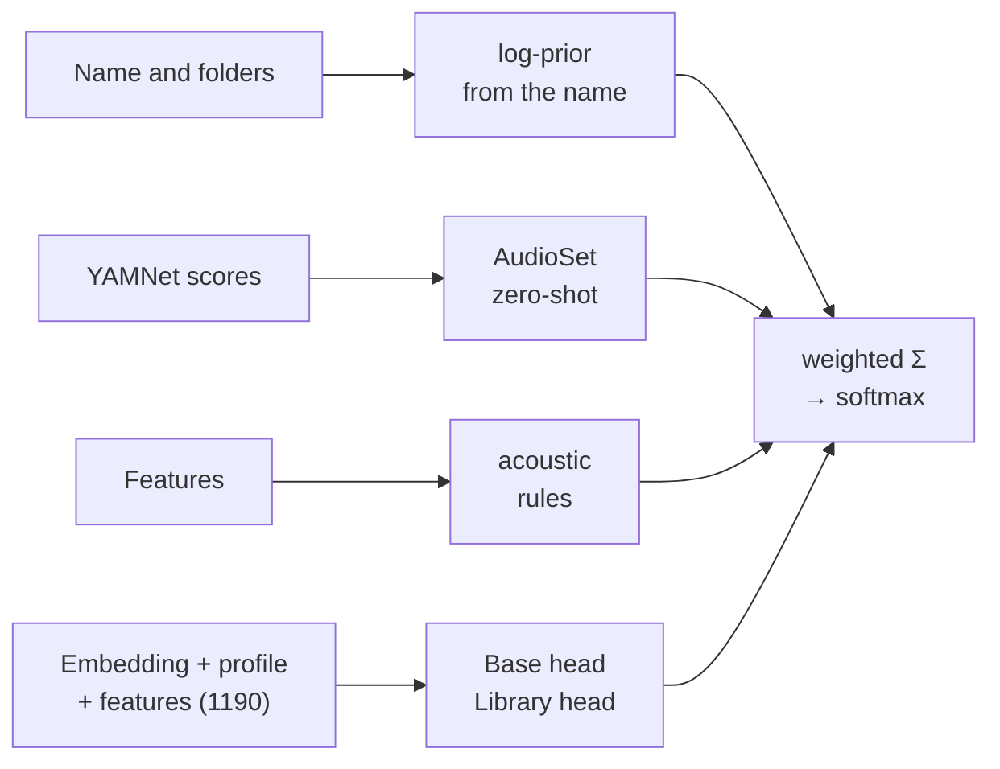

# Classifier

The classifier (`classifier.py`) assigns every sample to one of the [34 classes](../reference/classes.md). It is not
a single model but the **fusion of four independent signals**, two of which are neural networks (MLPs) working on
top of the [YAMNet](yamnet.md) embedding.

## Architecture of the heads

Both heads are an **MLP with one hidden layer**:

\[
\mathbf{x} = [\,\hat{\mathbf{e}}_{1024}\;;\;\mathbf{m}_{144}\;;\;\mathbf{f}_{22}\,] \in \mathbb{R}^{1190}
\qquad
\mathbf{p} = \operatorname{softmax}\!\Big(W_2\,\operatorname{ReLU}\big(W_1\,\tfrac{\mathbf{x}-\mu}{\sigma} + b_1\big) + b_2\Big)
\]

- \(\hat{\mathbf{e}}\): L2-normalised YAMNet embedding; \(\mathbf{m}\): mel profile (attack spectrum, body spectrum,
  envelope); \(\mathbf{f}\): the 22 [acoustic features](../algorithms/audio-analysis.md) (with `log1p` on the tails).
- Hidden layer of **256** ReLU units; standardisation with the mean and deviation of the training set.
- Weights \(W_1, W_2\) saved in float16.

**Training** (`train_head`), in pure numpy:

| Hyperparameter | Library head | Base head |
|---|---|---|
| Optimiser | Adam (β 0.9 / 0.999) | same |
| Steps × batch | 1500 × 256 | 4000 × 256 |
| Learning rate | 3·10⁻³, linear decay in the second half | same |
| Regularisation | weight decay 10⁻³, dropout 0.2 | same |
| Sampling | class-balanced (prob. ∝ weight / class size) | same |
| Minimum classes | ≥ 4 examples per class, at least 2 classes | ≥ 8 examples |
| Initialisation | He (\(\mathcal{N}(0, 2/d)\)) | same |

Balanced sampling makes the cost independent of the size of the library: 1500 steps take a few seconds even with
tens of thousands of files.

### Base head

Shipped with the app (`models/base_head.npz`, 0.6 MB, 34 classes), trained with `tools/train_base_head.py` on about
**27,000** labelled samples: a file becomes an example only if its name contains **a single** strong keyword
(score ≥ 0.75), with at most 4000 examples per class. It guarantees a good classification even in a library without
meaningful names. If the taxonomy changes, the app refuses to load an incompatible head.

### Library head (self-training)

Retrained at **every classification** on the open library. The examples are:

- the files whose **name** (not the folders) gives a keyword with score ≥ 0.75 — weight 1;
- the user's **manual corrections** — weight 3.

It is the heart of the approach: in a real library many files have clear names (`Kick 04.wav`) and others do not
(`A101.wav`, `sample_23.wav`). The head learns how the kicks and snares **of that library** *sound* from the named
files and recognises them in the anonymous ones. Correcting a sample adds a heavy example and restarts the training
in the background: the other classifications update within a few seconds.

### Output of the heads

Every head produces a bounded additive evidence, so that none can cancel the other signals on its own:

\[
h_c = \operatorname{clip}\big(\log(p_c \cdot k),\,-3,\,2\big) \quad\text{for the trained classes}, \qquad h_c = 0 \text{ otherwise}
\]

where \(k\) is the number of classes of the head (\(p_c \cdot k = 1\) is "no preference").

## The other signals

**Name and folders.** The tokenizer splits the path on separators, camelCase and letter/digit boundaries; the
taxonomy keywords give a score per class (1.0, or less for ambiguous tokens such as `cl`, `op`). The file name
weighs 1, the folders 0.65 · 0.45 · 0.3 · 0.2 going up. The log-prior is

\[
p_c = \frac{0.15}{K} + 0.85\,\frac{v_c^2}{\sum v^2},\qquad
n_c = \big(\log p_c - \log\tfrac{1}{K}\big)\cdot\max v
\]

so weak evidence (only a folder) pushes less. Special rules handle "open hat" vs "hat", "808" next to another drum
name, generic FX words.

**YAMNet zero-shot.** \(s = 0.5\,s_{\max} + 0.5\,s_{\text{mean}}\) over the 521 AudioSet scores; for every class the
maximum of \(s_i \cdot w_{i,c}\) over the mapped AudioSet classes (e.g. Clap ← *Clapping* 1.0, *Applause* 0.6), then
\(\log(x + 0.02)\).

**Acoustic rules.** Sigmoid-shaped additive priors computed from the features: low-end energy (kick, 808, tom vs
bass), decay and T60 (closed vs open hat, crash, tonal tail of the 808), duration (very short clicks, long pads and
textures), tonality vs noise, sweep direction (riser vs downlifter). Details in
[Algorithms › Classification](../algorithms/classification.md).

## Fusion and decision

\[
\mathbf{P} = \operatorname{softmax}\big(2.0\,\mathbf{n} + 0.25\,\mathbf{a} + 0.25\,\mathbf{r} + 2.0\,\mathbf{h}_{\text{lib}} + 1.5\,\mathbf{h}_{\text{base}}\big)
\]

Without any head (edge case) the weights become \(2.0\,\mathbf{n} + 1.0\,\mathbf{a} + 0.8\,\mathbf{r}\). The weights
were tuned with `tools/evaluate.py`.

- The **class** is the argmax if \(P \ge 0.22\), otherwise *Unsorted*.
- The top 4 classes are saved as **alternatives** (shown in the drawer).
- A **manual label** always wins (confidence 1.0).

## Accuracy

`tools/evaluate.py` hides the name and folders of the files (5-fold cross-validation) and compares the predicted
class with the one given by the name. Test library: 4,932 files, 2,845 labelled; the base head was trained on
**other** ~22,000 samples (duplicates excluded).

| Scenario | All | One-shots only |
|---|---|---|
| Files without a name, but the library holds other files with names (typical case) | 72% | 77% |
| No names in the whole library (audio + base head only) | 57% | 65% |
| YAMNet zero-shot + rules only, without heads (reference) | 16% | — |

Files with a meaningful name are almost always classified by their name. The remaining errors are confusions between
close classes (snare/clap/rimshot, closed/open hat, bass/synth) and label noise (e.g. "snare roll" inside a drum
fill).
