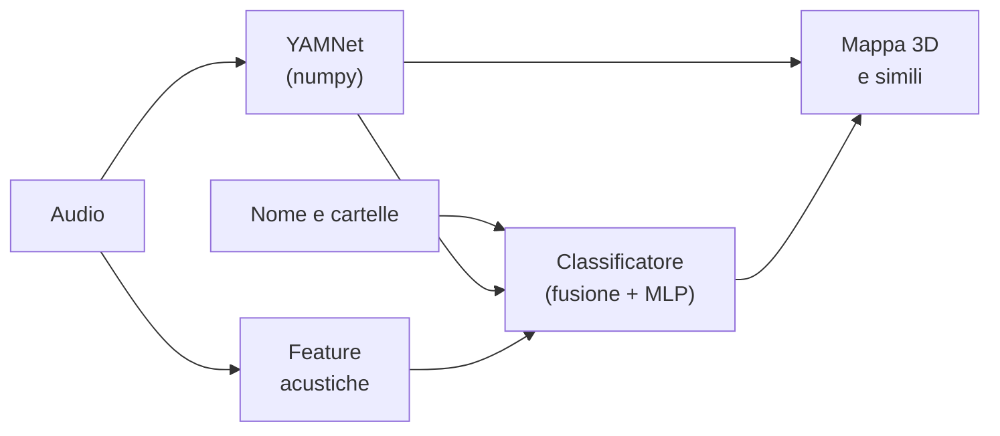

# Modelli AI

ClusterSound usa quattro modelli, tutti **in locale**: l'audio non lascia mai il computer e nessun servizio esterno
viene interpellato (la rete serve solo a scaricare una volta i pesi degli extra).

| Modello | Funzione | Runtime | Peso | Sempre presente |
|---|---|---|---|---|
| [YAMNet](yamnet.md) (Google, MobileNet v1 su AudioSet) | embedding 1024-d e score su 521 classi | **numpy puro** | 6,9 MB (float16) | sì |
| [Head MLP](classifier.md) base + di libreria | classificazione nelle 34 classi | numpy | 0,6 MB + addestrata al volo | sì |
| [Demucs](demucs.md) `htdemucs_6s` (Meta) | separazione in 6 stem | PyTorch (extra `stems`) | ~55 MB | no |
| [Apollo](apollo.md) (Li & Luo, 2024) | restauro di audio compresso | PyTorch (extra `enhance`) | 66 MB | no |

## Scelte architetturali

- **Niente framework per l'analisi.** YAMNet è riscritto in numpy (convoluzioni come matmul BLAS, BatchNorm fuso
  nei pesi). Rispetto a TensorFlow o a onnxruntime (~70 MB da solo) l'app resta piccola, parte in fretta e non ha
  dipendenze native da distribuire.
- **Un modello generico + una piccola rete addestrata sui tuoi dati.** YAMNet non conosce "closed hat" o "808":
  le sue rappresentazioni però separano bene questi suoni. Una head MLP trasforma l'embedding nelle 34 classi; una
  seconda head si **auto-addestra su ogni libreria** usando come etichette i nomi dei file (e le tue correzioni).
- **Fusione esplicita, non una scatola nera.** Nome, zero-shot di YAMNet, regole acustiche e head sono sommati in
  log-probabilità con pesi fissi e tarati con `tools/evaluate.py`: ogni segnale è ispezionabile e il sistema
  degrada bene quando uno manca (es. file senza nome).
- **Modelli pesanti isolati.** PyTorch è un extra; Apollo gira in un **processo separato** che termina a fine
  lavoro restituendo tutta la memoria; Demucs viene importato solo quando parte una separazione. Entrambi
  lavorano **a blocchi** con dissolvenza incrociata, per avere memoria costante, avanzamento e annullamento.
- **Device automatico.** `paths.torch_device()` sceglie CUDA, poi Apple MPS, poi CPU; se un'operazione manca
  sulla GPU, il lavoro prosegue su CPU.
