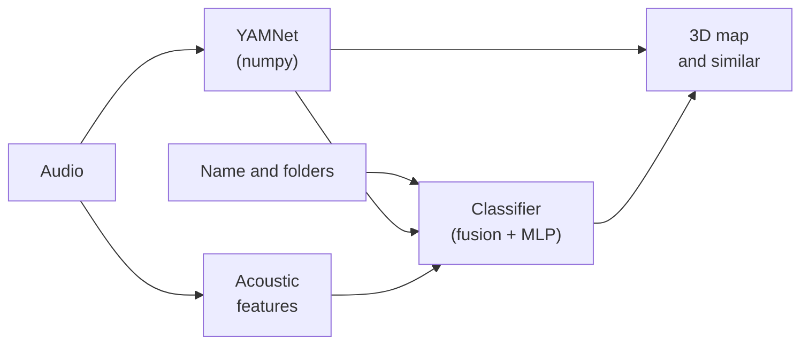

# AI models

ClusterSound uses four models, all **local**: the audio never leaves the computer and no external service is
contacted (the network is only used to download the weights of the extras once).

| Model | Function | Runtime | Size | Always present |
|---|---|---|---|---|
| [YAMNet](yamnet.md) (Google, MobileNet v1 on AudioSet) | 1024-d embedding and scores on 521 classes | **pure numpy** | 6.9 MB (float16) | yes |
| [MLP head](classifier.md) base + library | classification into the 34 classes | numpy | 0.6 MB + trained on the fly | yes |
| [Demucs](demucs.md) `htdemucs_6s` (Meta) | separation into 6 stems | PyTorch (`stems` extra) | ~55 MB | no |
| [Apollo](apollo.md) (Li & Luo, 2024) | restoration of compressed audio | PyTorch (`enhance` extra) | 66 MB | no |

## Architectural choices

- **No framework for the analysis.** YAMNet is rewritten in numpy (convolutions as BLAS matmuls, BatchNorm folded
  into the weights). Compared to TensorFlow or onnxruntime (~70 MB on its own) the app stays small, starts fast and
  has no native dependencies to ship.
- **A generic model + a small network trained on your data.** YAMNet does not know "closed hat" or "808": its
  representations, however, separate these sounds well. An MLP head turns the embedding into the 34 classes; a
  second head **self-trains on every library** using the file names (and your corrections) as labels.
- **Explicit fusion, not a black box.** Name, YAMNet zero-shot, acoustic rules and heads are summed in
  log-probability with fixed weights tuned with `tools/evaluate.py`: every signal can be inspected and the system
  degrades gracefully when one is missing (e.g. files without a name).
- **Heavy models isolated.** PyTorch is an extra; Apollo runs in a **separate process** that ends when the job is
  done, giving all the memory back; Demucs is imported only when a separation starts. Both work **in blocks** with a
  crossfade, for constant memory, progress and cancellation.
- **Automatic device.** `paths.torch_device()` picks CUDA, then Apple MPS, then CPU; if an operation is missing on
  the GPU, the job goes on on the CPU.
