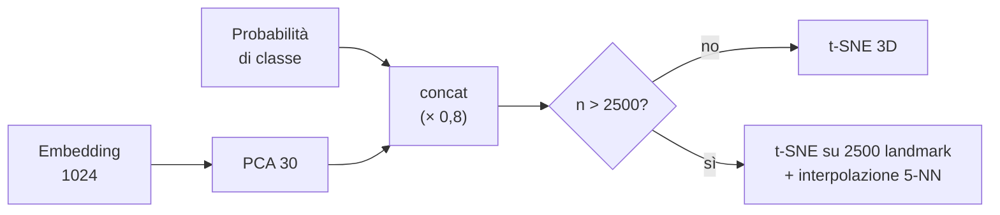

# Clustering e mappa 3D

Tre strutture organizzano la libreria: i **sottocluster** dentro ogni classe, i **vicini** di un sample e la **mappa
3D**. Tutte partono dagli embedding YAMNet normalizzati L2, così la distanza euclidea e il coseno sono equivalenti.

## Sottocluster (`clustering.py`)

Dentro ogni classe i sample vengono divisi in gruppi di suoni simili (es. kick corti e secchi vs kick lunghi e
distorti). Servono al Drum Rack e al Sequencer per scegliere "un gruppo di sample simili" e per tenere diversi i
gruppi di un kit.

1. Con meno di 6 sample: un solo cluster.
2. Su un campione di al massimo 800 sample si prova **k = 2 … min(8, n/3)** con k-means++ (fino a 50 iterazioni).
3. Ogni k è valutato con la **silhouette media**; si sceglie il migliore, ma solo se la silhouette supera
   **0,05**: altrimenti la classe è omogenea e resta un cluster.
4. Il k-means finale gira su tutti i sample della classe; i cluster sono rinumerati per dimensione (#1 = il più
   grande).

La silhouette misura quanto ogni punto è più vicino al proprio cluster che al più vicino degli altri: è un criterio
senza parametri che evita di spezzare classi senza struttura.

## Simili (kNN)

*Trova simili* e il Drum Rack usano la **somiglianza coseno** \(\hat{e}_i \cdot \hat{e}_j\) tra embedding: il sample
stesso è escluso e si restituiscono i primi *k* con la loro percentuale. Con 70.000 sample è un solo prodotto
matrice-vettore in numpy.

## Mappa 3D (`projection.py`)

**Input.** Per ogni sample: PCA a 30 dimensioni degli embedding (scalata a norma media 1) concatenata con
**0,8 × le probabilità di classe**. Le probabilità avvicinano i sample della stessa classe senza schiacciarli:
la mappa resta organizzata per timbro, ma le classi formano regioni leggibili.

**Anteprima.** Una PCA a 3 componenti viene mostrata subito, mentre la t-SNE è in calcolo.

**t-SNE 3D in numpy.**

| Parametro | Valore |
|---|---|
| Dimensioni | input ridotto a 30 con PCA → 3 |
| Perplessità | 30 (al massimo (n − 1)/3), β trovato per bisezione (64 iterazioni), distanze normalizzate sulla mediana |
| Inizializzazione | PCA × 10⁻² + piccolo rumore (layout stabile tra un'esecuzione e l'altra) |
| Iterazioni | 600; *early exaggeration* 12 per le prime 250 |
| Momento | 0,5 poi 0,8 |
| Learning rate | max(n/12, 50), con guadagni adattivi (+0,2 / ×0,8) |

**Landmark.** La t-SNE esatta è quadratica nel numero di punti. Oltre **2500** sample gira su 2500 landmark casuali;
ogni altro sample viene posto alla media dei suoi **5 landmark più vicini** (nello spazio PCA) pesata per l'inverso
della distanza, più un piccolo jitter (0,02 · deviazione standard) perché i punti non si sovrappongano.

**Normalizzazione e cache.** Le coordinate sono centrate sulla mediana e scalate in modo che il 98° percentile di
|coordinata| valga 50. Il layout è salvato nella tabella `projections` con una chiave SHA-1 di cartella + file.

