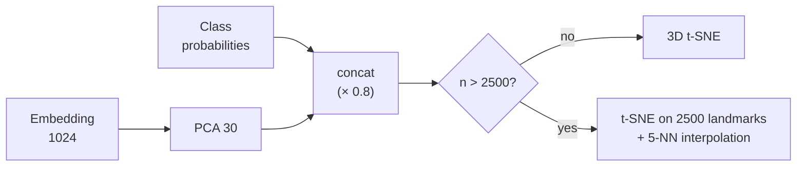

# Clustering and 3D map

Three structures organise the library: the **subclusters** inside every class, the **neighbours** of a sample and
the **3D map**. All of them start from the L2-normalised YAMNet embeddings, so Euclidean distance and cosine are
equivalent.

## Subclusters (`clustering.py`)

Inside every class the samples are split into groups of similar sounds (e.g. short dry kicks vs long distorted
kicks). The Drum Rack and the Sequencer use them to pick "a group of similar samples" and to keep the groups of a
kit different.

1. With fewer than 6 samples: a single cluster.
2. On a sample of at most 800 items, **k = 2 … min(8, n/3)** is tried with k-means++ (up to 50 iterations).
3. Every k is scored with the **mean silhouette**; the best one is chosen, but only if the silhouette exceeds
   **0.05**: otherwise the class is homogeneous and stays one cluster.
4. The final k-means runs on all the samples of the class; the clusters are renumbered by size (#1 = the largest).

The silhouette measures how much closer every point is to its own cluster than to the nearest of the others: it is a
parameter-free criterion that avoids splitting classes without structure.

## Similar (kNN)

*Find similar* and the Drum Rack use the **cosine similarity** \(\hat{e}_i \cdot \hat{e}_j\) between embeddings: the
sample itself is excluded and the first *k* are returned with their percentage. With 70,000 samples it is a single
matrix-vector product in numpy.

## 3D map (`projection.py`)

**Input.** For every sample: 30-dimensional PCA of the embeddings (scaled to mean norm 1) concatenated with
**0.8 × the class probabilities**. The probabilities bring samples of the same class closer without squashing them:
the map stays organised by timbre, but the classes form readable regions.

**Preview.** A 3-component PCA is shown straight away, while the t-SNE is being computed.

**3D t-SNE in numpy.**

| Parameter | Value |
|---|---|
| Dimensions | input reduced to 30 with PCA → 3 |
| Perplexity | 30 (at most (n − 1)/3), β found by bisection (64 iterations), distances normalised on the median |
| Initialisation | PCA × 10⁻² + a little noise (stable layout between runs) |
| Iterations | 600; *early exaggeration* 12 for the first 250 |
| Momentum | 0.5 then 0.8 |
| Learning rate | max(n/12, 50), with adaptive gains (+0.2 / ×0.8) |

**Landmarks.** Exact t-SNE is quadratic in the number of points. Beyond **2500** samples it runs on 2500 random
landmarks; every other sample is placed at the mean of its **5 nearest landmarks** (in PCA space) weighted by the
inverse of the distance, plus a little jitter (0.02 · standard deviation) so that points do not overlap.

**Normalisation and cache.** The coordinates are centred on the median and scaled so that the 98th percentile of
|coordinate| is 50. The layout is saved in the `projections` table with a SHA-1 key of folder + files.

