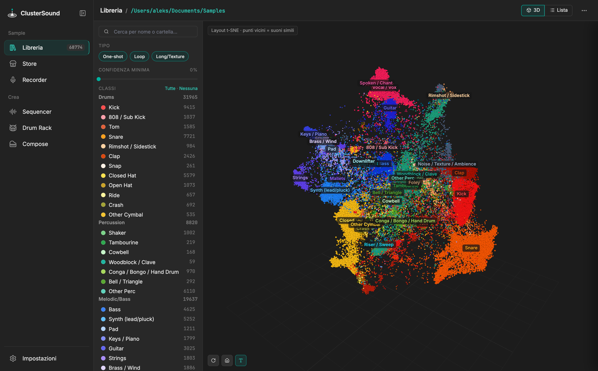

---
hide:
  - navigation
---

# ClusterSound

**Classify, explore in 3D and put your sample library to work.** A desktop app for macOS and Windows that
analyses a folder of audio samples, assigns every file to a sound class — kick, snare, hat, 808, pad… — and
shows the whole library as a 3D cloud where similar sounds sit close together. From there you build kits, grooves
and progressions and take them into Ableton Live. Everything runs locally and your files are never modified.

{ .shot }

[Install :material-download:](guide/installation.md){ .md-button .md-button--primary }
[Manual :material-book-open-variant:](manual/index.md){ .md-button }
[How it works :material-cog:](technical/index.md){ .md-button }

## What it does

- :material-scatter-plot: **Library** — 34 classes, subgroups of similar sounds, t-SNE 3D map, *Find similar*,
  corrections that teach the classifier. [→](manual/library.md)
- :material-store: **Store** — free samples and packs from Freesound, Openverse, Internet Archive and ccMixter,
  filtered by instrument and licence. [→](manual/store.md)
- :material-microphone: **Recorder** — records the audio output, slices on transients, separates stems and restores
  compressed audio with AI. [→](manual/recorder.md)
- :material-view-grid: **Sequencer** — 191 grooves in 47 genres to try samples, layers, arrangement and export
  for Ableton. [→](manual/sequencer.md)
- :material-grid: **Drum Rack** — kits of similar samples for an 8×8 Launchpad and a Roland SPD-SX. [→](manual/drum-rack.md)
- :material-piano: **Compose** — progressions from a chord pack with harmonic suggestions, variations, generated
  melodies and bass lines. [→](manual/compose.md)

## How it is built

- **[Quick start](guide/index.md)** — installation, first launch, Ableton Live, build: a few steps.
- **[Manual](manual/index.md)** — every section of the app, with screenshots.
- **[Technical](technical/index.md)** — architecture, Python backend, web frontend, data, Live integration.
- **[AI models](ai/index.md)** — YAMNet in numpy, self-trained MLP classifier, Demucs, Apollo.
- **[Algorithms](algorithms/index.md)** — classification, clustering, sample choice, grooves, harmony, melody.
- **[Reference](reference/classes.md)** — classes, settings, shortcuts.

!!! note "Language"
    The app and this documentation are in English; both are also available in Italian. In the app choose the
    language in **Settings › General › Language**; here use the language menu at the top of the page.
