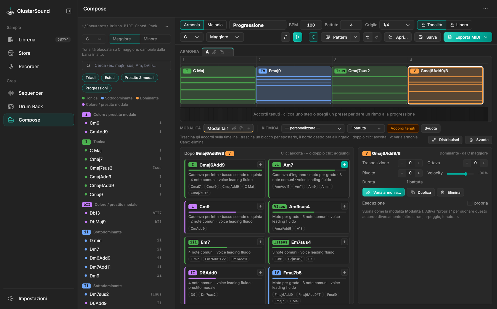

# Compose

Costruisce **progressioni di accordi** con le clip MIDI di un chord pack. L'app include un **pack generato**
per tutte le 12 tonalità (triadi, accordi estesi, accordi presi in prestito e modali, progressioni), usato di
default. Se hai un pack organizzato come l'**Unison MIDI Chord Pack**, scegli la sua cartella in Impostazioni ›
Compose (*Usa quello incluso* torna indietro). Il pack non viene mai modificato: i file sono letti e indicizzati in
memoria.

{ .shot }

## Browser degli accordi

- Gli accordi della tonalità scelta, raggruppati per **grado** (I, ii, bVII…) e colorati per **funzione**: verde
  tonica, blu sottodominante, arancio dominante, viola colore/prestito modale.
- Filtri *Triadi*, *Estesi*, *Prestito & modali*, *Progressioni* e ricerca per nome o grado.
- Clic: ascolta · doppio clic, **+** o trascinamento sulla timeline: aggiunge. Le progressioni del pack entrano
  come un blocco per accordo. Tonalità o categorie mancanti nel pack vengono trasposte dalla più vicina.

## Tonalità

- **🔒 Tonalità**: mostra solo gli accordi di quella tonalità; cambiarla traspone l'intera progressione.
- **Libera**: accordi da qualsiasi tonalità, ognuno trasponibile ±12 semitoni.
- In entrambi i casi la tonalità in alto è il riferimento per gradi e suggerimenti.

## Timeline

Lunghezza in battute e griglia (1 battuta … 1/16) a scelta. Trascina un blocco per spostarlo, il bordo destro per
cambiarne la durata: gli accordi successivi scorrono invece di sovrapporsi. *⇔ Distribuisci* dà a tutti la stessa
durata. Ogni blocco mostra le note che suonano davvero (dopo strum, arpeggi e ritmo). Versioni **A, B, C…** nelle
schede sopra la timeline.

## Prossimo accordo

Suggerimenti per l'accordo selezionato (o l'ultimo), con un punteggio e i motivi: funzione armonica, cadenze
(V → I, ii → V, d'inganno, plagale, bVI → bVII…), moto del basso, note comuni, voice leading e frequenza della mossa
nelle progressioni del pack. Se dopo il blocco c'è già un accordo, conta anche quanto bene il suggerimento ci
conduce. Sotto ogni proposta le varianti di colore dello stesso grado. Formula completa in
[Algoritmi › Armonia](../algorithms/harmony.md#prossimo-accordo).

## Esecuzione

Per accordo o come default della sequenza (*Modalità*):

- *Block*, *Strum* (↑, ↓ o alternato, 5–80 ms), *Arpeggio* (su, giù, su-giù, casuale; 1/4…1/16 e terzine; 1–2
  ottave);
- *Ritmo* (semiminime, ottavi, offbeat, charleston, tresillo, sincopato house, minime, pulse 1/16) suonato a block
  o a strum;
- durata delle note, swing, curva di dinamica, **humanize** (timing, velocity, feel, deriva… 🎲 lo rigenera) e
  **Alterna** stili a ogni colpo o battuta.

Anteprima ed export usano gli stessi eventi, calcolati in Python.

## Variazioni

- **Di un accordo** (*✦ Varia…* o `V`): voicing (rivolti, drop-2, open/close, basso raddoppiato, voice leading
  minimo dal precedente), colore (stesso grado, estensioni diverse), sostituzioni nel contesto, modi di
  esecuzione. ▶ ascolta la proposta dalla battuta prima.
- **Della progressione** (*✦ Genera variazioni…*): riarmonizzazione (primo e ultimo accordo restano), ritmo
  armonico (anticipi, lungo-corto, accordi divisi), voice leading, più ricca / più scarna, esecuzione e finale
  (IV → V, bVI → bVII, IV → iv, ii → V…), con uno slider *Quanto variare*. *Tieni* la salva come nuova versione,
  *Accoda* la aggiunge in fondo.

## Esportare

- **Esporta MIDI**: un `.mid` (tipo 0, 480 PPQ, con il tempo) per la versione corrente o uno per versione;
  *solo accordi* esporta i voicing a block senza stile. Con una melodia: *Accordi + melodia* (tipo 1), *Solo
  accordi* o *Solo melodia*.
- **Invia a Live**: traccia *Accordi* con una clip per versione, più una traccia per ogni layer di melodia.
- **Pattern**: suona la progressione insieme al pattern del Sequencer.
- *Salva* / *Apri…* tengono le progressioni con tutte le versioni; `⌘Z` / `⇧⌘Z` annullano e ripetono.

Scorciatoie: `Spazio` play/stop, `←` `→` accordo precedente/successivo, `Canc` elimina, `⌘D` duplica, `V` variazioni.
