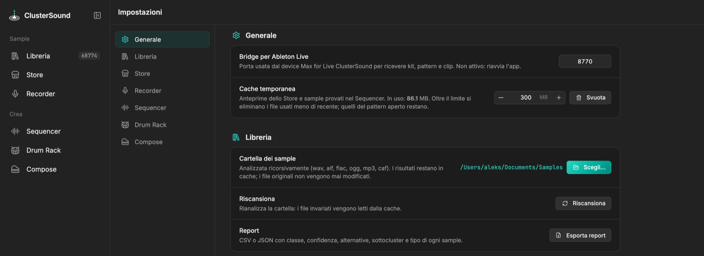

# Interfaccia

{ .shot }

- **Navigazione**: il pannello a sinistra elenca le sezioni; il pulsante accanto al logo lo riduce a sole icone.
  La Libreria mostra il numero di sample analizzati; il Recorder un pallino rosso mentre registra.
- **Impostazioni**: le opzioni di fino di ogni sezione (cartelle, formati, dispositivi, mappature MIDI…) sono
  raccolte in *Impostazioni*, divise per sezione e salvate subito. Il pulsante **⋯** in alto a destra di ogni
  schermata apre direttamente la sezione relativa.
- **Le sezioni si parlano**: un sample della Libreria o dello Store si invia al Sequencer o al Drum Rack con il
  menu **Invia** (tasto destro su un punto 3D o su una riga); il Drum Rack carica i suoi sample nei bus del
  Sequencer; il Recorder manda le regioni al Drum Rack; Compose suona insieme al pattern del Sequencer; tutto si
  può inviare ad Ableton Live.
- **Nessun file viene modificato**: l'app scrive solo nelle sue cartelle (dati, cache, `~/Music/ClusterSound …`).

| Impostazioni › Generale | |
|---|---|
| Lingua | lingua dell'interfaccia: English (predefinita) o Italiano; l'app si ricarica per applicarla |
| Bridge per Ableton Live | porta del server locale per il device (default 8770) |
| Cache temporanea | limite delle anteprime online e dei sample provati (default 300 MB), *Svuota* |

Le altre impostazioni sono descritte nella pagina di ciascuna sezione; l'elenco completo è in
[Riferimento › Impostazioni](../reference/settings.md). Le scorciatoie sono in
[Riferimento › Scorciatoie](../reference/shortcuts.md).

!!! info "Windows"
    Tutto funziona come sul Mac: scorciatoie con `Ctrl` al posto di `⌘`, *Mostra nella cartella* apre Esplora
    file, la finestra usa Edge WebView2. I nomi riservati (`CON`, `NUL`, `COM1`…) ricevono un `_` davanti.
