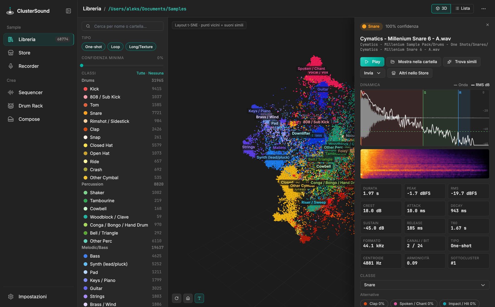
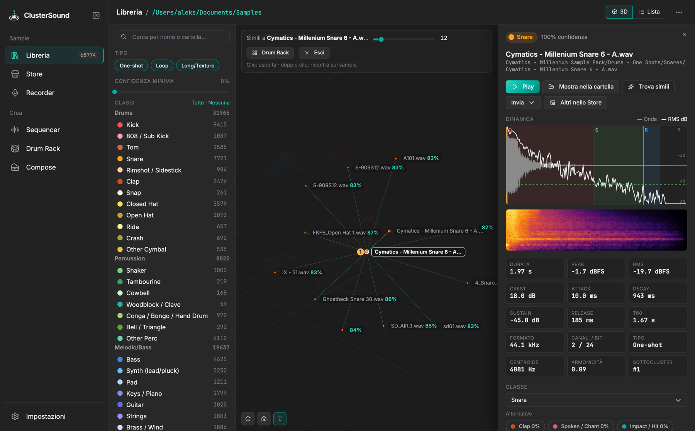
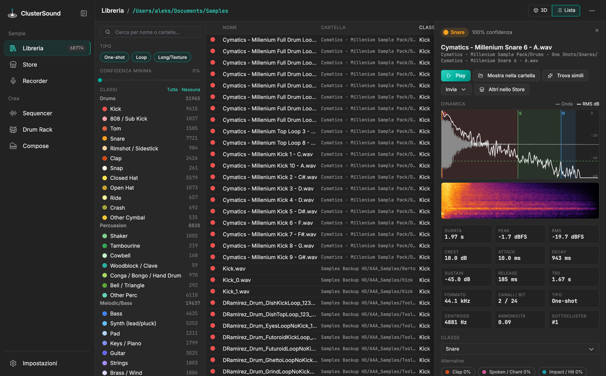

# Libreria

La Libreria analizza una cartella di sample (ricorsivamente), assegna ogni file a una delle
[34 classi](../reference/classes.md) e mostra l'intera libreria come **nuvola 3D**: suoni simili stanno vicini,
il colore di un punto è la sua classe.

{ .shot }

## Cartella e scansione

- **Scegli cartella…** (dalla libreria vuota o da Impostazioni › Libreria): formati wav, aif, flac, ogg, mp3,
  caf, w64.
- I risultati finiscono in cache: una **Riscansione** rilegge solo i file nuovi o modificati. All'avvio l'ultima
  cartella si ripristina da uno snapshot senza rianalizzare nulla.
- I download dello Store salvati dentro la cartella della libreria vengono aggiunti con una riscansione automatica.

## Vista 3D

- Trascina per ruotare, scroll per lo zoom, tasto destro per spostare. In basso: rotazione automatica, reimposta vista,
  etichette delle classi on/off.
- **Clic su un punto**: riproduzione immediata e apertura della tendina di dettaglio.
- **Doppio clic**: *Trova simili* su quel sample.
- **Tasto destro**: menu *Invia* (Sequencer, Drum Rack).

## Tendina di dettaglio

{ .shot }

- **Dinamica**: forma d'onda con inviluppo RMS in dB e fasi ADSR stimate.
- **Spettrogramma**: clic per riprodurre da quel punto.
- **Misure**: durata, peak, RMS, crest, attack, decay, sustain, release, T60, formato, canali/bit, tipo,
  centroide, armonicità, sottocluster.
- **Classe e alternative**: le classi più probabili con la loro confidenza.
- **Azioni**: *Play*, *Mostra nella cartella*, *Trova simili*, *Invia ▾*, *Altri nello Store* (apre lo Store sulla
  stessa classe).

## Correggere una classe

Cambia la classe dal menu *Classe* della tendina: il sample diventa un **esempio di training** e in pochi
secondi tutte le altre classificazioni si aggiornano (la head della libreria viene riaddestrata). Le etichette
manuali restano in cache e sopravvivono alle riscansioni. Vedi [Classificatore](../ai/classifier.md).

## Trova simili

{ .shot }

Mostra i sample più vicini (somiglianza coseno sugli embedding YAMNet) disposti attorno al centro, con la
percentuale di somiglianza. Lo slider sceglie quanti mostrarne (5–60).

- **Clic** ascolta, **doppio clic** ricentra sul sample: le tappe formano un **percorso**, che il Drum Rack può
  usare per riempire un gruppo (*Percorso*).
- **▦ Drum Rack** riempie il gruppo selezionato con i simili; **Esci** torna alla nuvola.

## Filtri e lista

{ .shot }

- **Classe**: clic per accendere/spegnere, `Alt`+clic = solo quella; *Tutte · Nessuna*.
- **Tipo**: One-shot, Loop, Long/Texture.
- **Confidenza minima** e **ricerca** per nome o cartella.
- **Lista**: tabella ordinabile; `↑` `↓` scorrono e ascoltano.

## Esporta report

Impostazioni › Libreria › **Esporta report**: CSV o JSON con percorso, classe, confidenza, alternative,
sottocluster e tipo di ogni sample. Lo stesso report si ottiene senza GUI con `--headless`.

Scorciatoie: `Spazio` play/stop, `Esc` chiude la tendina.
