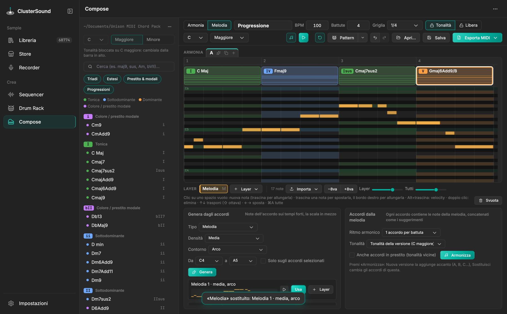

# Melodia

In Compose, **Armonia | Melodia** cambia vista. Ogni versione (A, B, C…) ha la sua melodia, che suona insieme agli
accordi in entrambe le viste (♫ nella barra la silenzia).

{ .shot }

## Layer

La melodia è fatta di uno o più **layer** sugli stessi accordi — *Melodia*, *Basso*, *Arpeggio*, *Riff*, *Pad*,
*Keys* — ognuno col suo suono e colore.

- *＋ Layer ▾* ne aggiunge uno vuoto; clic sul nome lo rende attivo (gli altri si vedono in trasparenza); doppio clic
  lo rinomina; **M** lo silenzia; ✕ lo elimina.
- Due cursori: volume del layer attivo e di tutti i layer.

## Piano roll

Le righe della scala sono più chiare e sotto ogni accordo sono evidenziate le sue note.

- Clic su uno spazio vuoto: nuova nota (trascina per allungarla); trascina una nota per spostarla, il bordo destro
  per allungarla, `Alt`+trascina per la velocity; doppio clic la elimina.
- `↑` `↓` traspongono (`⇧` di un'ottava), `←` `→` spostano, `⌘D` duplica, `⌘A` seleziona tutto; *−8va* / *+8va*.

## Importa

- **File MIDI**: la nota più alta di ogni accordo, quantizzata.
- **Clip di Ableton**: nel device premi *Clip → Melodia* con una clip MIDI selezionata.
- **Tastiera MIDI**: 4 click di attacco, poi suoni sopra la progressione (richiede l'extra `midi`).

Se la versione non ha accordi, la tonalità viene rilevata dalla melodia.

## Genera dagli accordi

Scegli *Tipo*, *Densità*, contorno o stile ed estensione (si imposta da sola sul registro del tipo), poi **Genera**:

| Tipo | Cosa genera |
|---|---|
| *Melodia* | contorno (arco, sale, scende, onda); note dell'accordo sui tempi forti, della scala in mezzo; frasi di 2–4 battute con una risposta |
| *Basso* | stile (fondamentali, ottave, quinte, passaggi); fondamentale sul primo tempo e nota di avvicinamento all'accordo dopo |
| *Arpeggio* | direzione (sale, scende, sale e scende, casuale) sulle note dell'accordo, a semiminime, crome o semicrome |
| *Riff* | una cellula di una battuta che segue gli accordi, variata ogni 4 battute |
| *Pad* / *Keys* | accordi con voicing legati, tenuti o ritmati |

*Solo sugli accordi selezionati* rigenera solo quelle battute. ▶ ascolta con gli altri layer, **Usa** sostituisce il
layer attivo (se dello stesso tipo), **＋ Layer** aggiunge la linea come nuovo layer.

## Accordi dalla melodia

**Armonizza** (dal layer attivo): un accordo per battuta, due, o quanti ne servono, scelti tra quelli del pack che
contengono le note della melodia e concatenati con gli stessi criteri dei suggerimenti. La tonalità può essere
quella della versione o rilevata dalla melodia; opzionalmente anche accordi in prestito. *Nuova versione* aggiunge
una versione con accordi e melodia, *Sostituisci* cambia gli accordi della versione corrente.

Algoritmi di generazione e armonizzazione: [Algoritmi › Melodia](../algorithms/melody.md).
