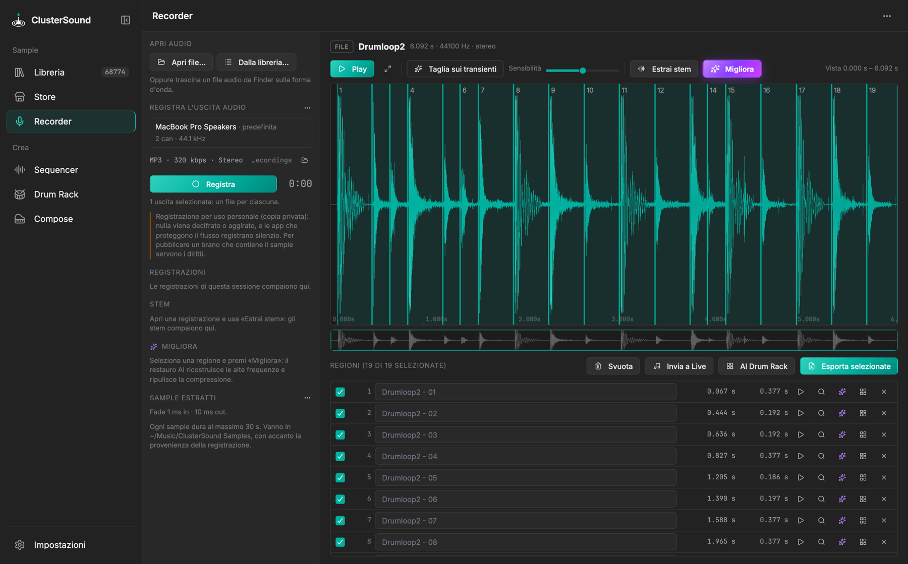

# Recorder

Records what the computer sends to one or more **audio outputs**, then cuts samples out of the recording: they go
into the library and are classified like the others. It also opens any audio file or library sample.

{ .shot }

The screen uses its whole width: the **file bar** on top, one **tab per open track** over the waveform, the
**transport** under it and the **Extractions** of all the open tracks at the bottom.

## Recording

- **● Record** is in the transport, with the clock and a small level meter per output (hover it for the output's
  name). The yellow ⚠ next to it recalls the legal note below; ⋯ opens the Recorder settings.
- **Outputs**: speakers, headphones, audio interfaces, AirPlay… plus *All outputs (mix)* (on Windows *Default
  output*). Several outputs start together, each with its own file and meter. *Refresh the list* reads the
  devices again.
- **Format** (Settings › Recorder): WAV 16/24 bit or 32 float, AIFF, FLAC 16/24, CAF, MP3 128–320 kbps, OGG
  Vorbis, Opus (48 kHz), M4A/AAC (macOS only). Device rate or 44.1/48/96 kHz; stereo, mono or all channels
  (uncompressed formats).
- **Folder**: `~/Music/ClusterSound Recordings/<date time> - <output>.<ext>` with a `.source.txt` of provenance.
  The recording goes on while you switch section.

## Opening audio

The file bar shows the path of the open audio. Its folder button asks where to open from: **Local folder…** (any
audio file of the computer), **Sample library…** (samples and loops by folder, pack or name) or one of the
**Recent recordings** of the session. An audio file dragged from the Finder onto the waveform opens too.

Every opened file gets its own **tab** over the waveform (a file already open just shows its tab); **+** opens
another one, **×** (or a middle click) closes it, asking first if it has cuts not exported yet. Slicing, stems,
Enhance and the transport work on the shown track.

## Editor and regions

- When you stop, the recording opens in a new tab. **Drag** on the waveform to create a region, the edges resize
  it, double click to listen to it.
- **Click** on the waveform to move the **cursor** there (and select the region under it): play starts from the
  cursor, and while playing a click jumps there.
- **Slice on transients** creates one region per hit in the visible part; its **⋯** sets the *Sensitivity* (how
  many hits it finds).
- Transport: **■** stop (the cursor goes back to the start of the track), **▶/❚❚** play and pause from the cursor
  (pausing leaves the cursor where it stopped), **⤢** shows the whole track.
- Wheel: zoom · `Shift`+wheel: scroll · the strip below moves the view · `Space` play/pause · `↑` `↓`
  previous/next region · `Del` delete.

## Extractions

Everything extracted from **all the open tracks**, in three tabs with a tick per row; with more than one track the
rows are grouped under its name (click it to show that track):

- **✂ Cuts**: the regions, cut by hand or on the transients.
- **Stems**: the stems of the open tracks, found again on disk when they open. The stems of the same separated
  audio (a track, a cut, an enhanced file) are grouped: click a group to open or close it, its tick ticks them all.
- **✨ Enhanced**: the enhanced files made from the tracks, from their cuts or from their stems.

Every row has icon-only buttons: listen, show the waveform (a cut is zoomed in; a stem or an enhanced file opens
in a new tab), **Extract stems** (cuts and enhanced files), ✨ Enhance (cuts and stems) and **Send**, the same menu as
in the library (a Sequencer bus or a Drum Rack group). Stems and enhanced files also have show in the Finder (greyed out until the file is saved
or sent to the library: clicking it offers to do one of the two) and 🗑 **delete**: a temporary file is deleted, a saved one goes to the Trash after a confirmation.

!!! info "Temporary until saved"
    New cuts, stems and enhanced files are **temporary**: they are kept in a work folder of ClusterSound while it is
    open, and deleted when it closes (○ next to the duration). **Export all** saves them (✓). Cuts sent to the Drum
    Rack or the Sequencer without saving them stay temporary too, so those pads are empty after a restart.

Next to the title:

- **Clear all** empties the tab, after a confirmation (stems and enhanced files stay on disk).
- **Send to**: the ticked rows to **Ableton Live** (one new audio track each; with no cut ticked, all the shown track),
  to the **Drum Rack** (on the free pads from the selected one) or to the **Sequencer** (new layers of the chosen
  bus), or to the **Library**: a copy in `ClusterSound Recorder/<track>/` of the library folder (asked when the
  library is made of several), analysed like the other samples. Live needs the ClusterSound device with *Receive* on.
- **Export all** saves the ticked rows into the **export folder** (Settings › Recorder, by default
  `~/Music/ClusterSound Samples/`). Cuts become 24-bit WAVs with fades (1 ms in, 10 ms out) and optional
  normalisation, at most 30 s each; stems and enhanced files move there with their provenance note.

## Extract stems

Separates the shown track or its region (or, from its row, a single cut or enhanced file) into **Drums, Bass, Guitar, Piano, Vocals** (those you tick) plus always
**Other** with the rest, so the sum gives back the original. One 24-bit WAV per stem, which can be opened in the
editor. The stems show up in the **Stems** tab. It runs locally with Demucs (`stems` extra, 55 MB model downloaded on first use). Details:
[Demucs](../ai/demucs.md).

## Enhance

Purple ✨ button, also on every cut and stem: **AI restoration** that rebuilds the cut high frequencies and cleans up the
artefacts of compression (MP3, streaming). The result is a new `… (enhanced).wav` file, listed in the **Enhanced** tab; the
original stays as it is. It runs locally with Apollo (`enhance` extra, 66 MB). Details: [Apollo](../ai/apollo.md).

!!! warning "Legal note"
    Nothing is decrypted or bypassed: apps that protect their stream record silence. Recordings are for personal
    use (private copy); to publish a track that contains a sample you need the rights to the original, or a
    sample with a free licence. There is no number of seconds below which a sample is free.

!!! info "Windows"
    Every output is recorded with WASAPI loopback: there is no mix of all the outputs, ClusterSound's own audio
    also ends up in the recording and the M4A format is not available. No permission to grant.
