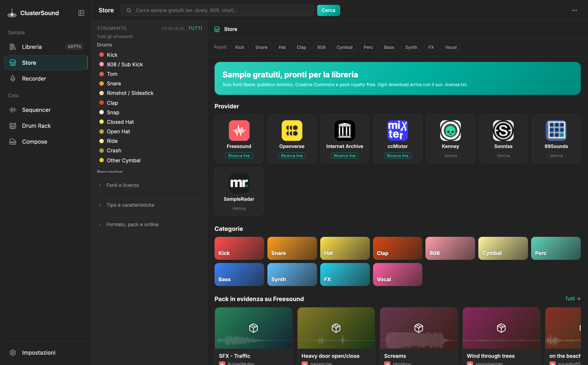
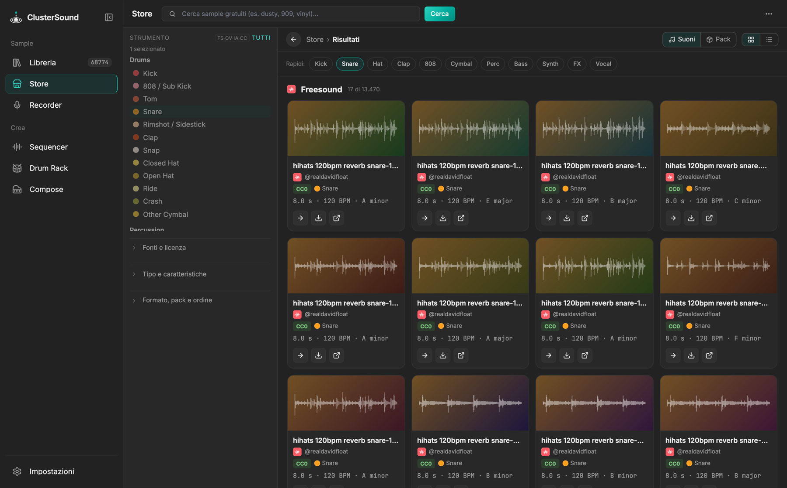

# Store

Uno store di **sample gratuiti**: cerca in quattro fonti libere contemporaneamente, ascolta subito e scarica con
la licenza accanto. Ci si arriva anche dalla libreria vuota (*Sfoglia lo Store gratuito*) e dalla tendina di un
sample (*Altri nello Store*).

{ .shot }

## Fonti

| Fonte | Cosa offre | Accesso |
|---|---|---|
| Freesound | ~600k suoni CC (one-shot, loop, field recording) con BPM, tonalità, waveform, organizzati in pack | API key gratuita (Impostazioni › Store → *richiedi una chiave*) |
| Openverse | Aggregatore CC (Freesound, Wikimedia Commons) | anonimo, limiti di frequenza bassi |
| Internet Archive | Sample pack interi, sfogliabili file per file anche dentro gli ZIP | anonimo |
| ccMixter | Stem, a cappella e loop CC | anonimo |

La **vetrina** elenca pack di siti senza API pubblica, utilizzabili in produzioni commerciali: Kenney (CC0),
Sonniss GameAudioGDC, 99Sounds, SampleRadar. Il pulsante apre la pagina ufficiale da cui scaricarli.

## Cercare

{ .shot }

- **Home**: un carosello dei siti (frecce per scorrere, clic per aprire la pagina del sito), poi per ogni sito con
  ricerca live un carosello di sample di esempio presi da categorie diverse (kick, snare, hat, percussioni, bass,
  synth, keys, voce, FX), infine la vetrina dei pack curati. La sidebar dei filtri compare solo nei risultati.
- **Badge di categoria** su ogni card: colore e nome della classe; **Classe ?** quando l'etichetta è incerta (solo
  parole ambigue, o quasi pareggio); **Mix** per loop, beat e kit con più strumenti.
- **Risultati**: *Suoni* o *Pack*, in griglia (card con forma d'onda, licenza, durata, BPM, tonalità) o in lista
  raggruppata per fonte o per strumento.
- **Filtro per strumento**: le stesse 34 classi e colori della libreria. I falsi positivi non musicali
  ("soccer kick", "waves crashing") vengono scartati.
- **Altri filtri**: fonte, licenza (CC0/PD, BY, BY-SA, NC, ND, non dichiarata), *solo uso commerciale*, tipo,
  durata, BPM, tonalità, solo lossless, file singoli o pack, ordinamento. L'etichetta accanto a ogni filtro
  (FS·OV·IA·CC) indica le fonti che lo applicano lato server; sulle altre è applicato localmente.
- **Pagina pack**: descrizione, licenza, numero di suoni, *Ascolta tutto*, *Scarica pack*, tracce una per una e
  altri pack dello stesso autore. **Pagina provider**: descrizione, licenze tipiche, link, pack e suoni.

## Ascoltare, scaricare, usare

- **▶** riproduce subito; **→** invia il sample al Sequencer o al Drum Rack senza scaricarlo (resta nella cache
  temporanea finché non esporti).
- **⬇** scarica in `~/Music/ClusterSound Downloads/<Fonte>/` (configurabile) con un `.license.txt` che riporta
  autore, licenza, link e testo di attribuzione. Da Freesound senza login OAuth si scarica l'anteprima HQ mp3;
  l'originale si scarica dalla pagina (↗).
- Se la cartella dei download sta dentro la libreria aperta, a fine download la libreria si aggiorna da sola;
  altrimenti il pannello dei download offre *Apri in libreria*.

!!! warning "Pack sospetti"
    I pack di Internet Archive che sembrano librerie commerciali ricaricate con una licenza libera (Big Fish
    Audio, Sound Ideas, Loopmasters, GarageBand…) sono marcati ⚠ e nascosti per default (Impostazioni › Store ›
    *Pack sospetti*). Quelli senza licenza dichiarata compaiono solo scegliendo *Non dichiarata*.

Come funzionano ricerca federata, etichettatura e cache: [Algoritmi › Store](../algorithms/store.md).
