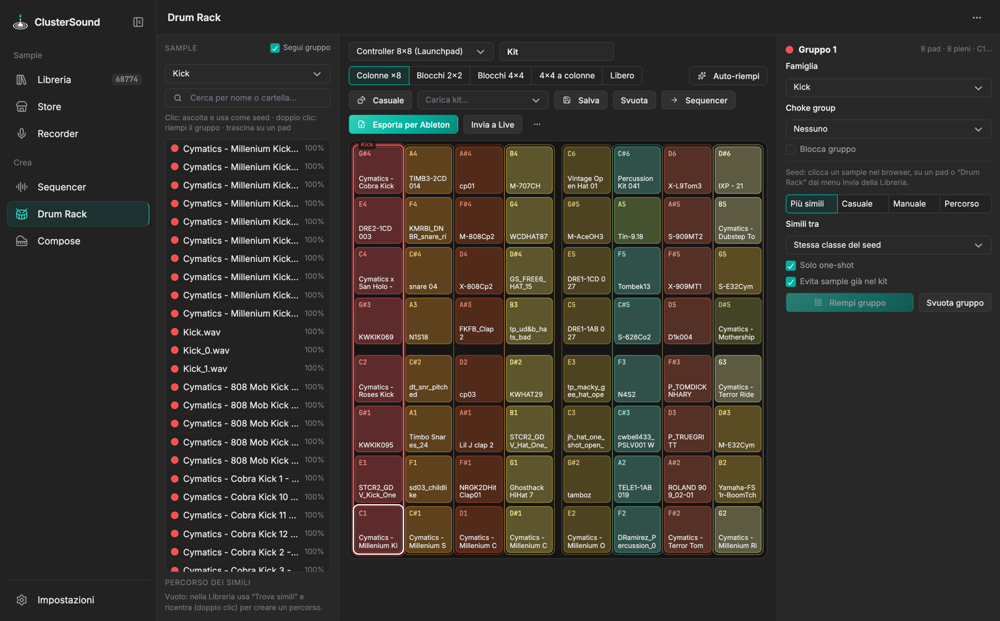
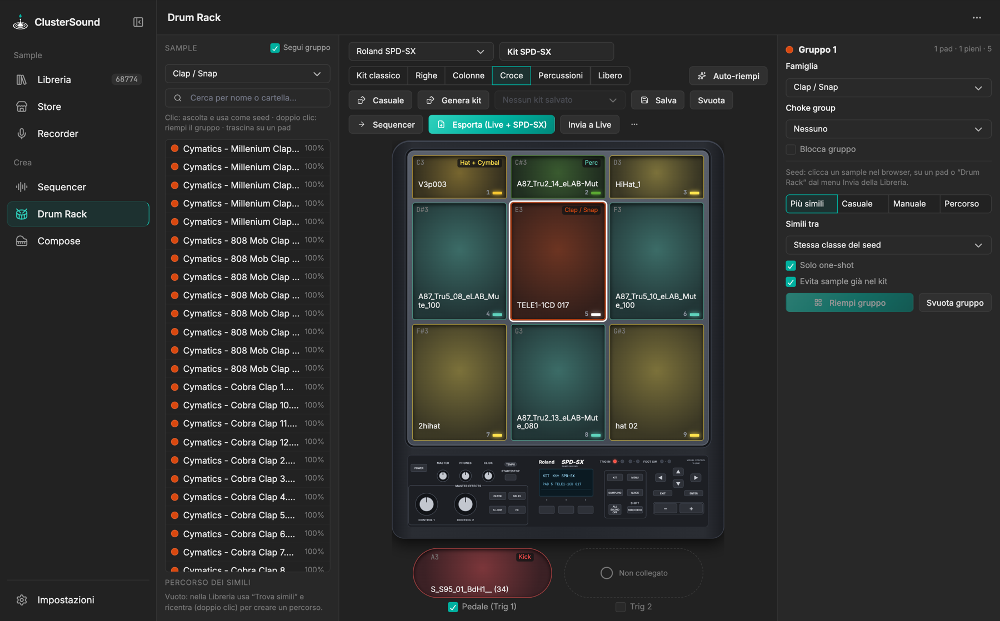

# Drum Rack

Costruisce kit di sample simili per due strumenti: un **controller 8×8** (Novation Launchpad Pro) o una **Roland
SPD-SX**. Il menu in alto a sinistra sceglie lo strumento; ognuno ha il suo kit.

{ .shot }

## Controller 8×8

- **Geometrie**: dividono i 64 pad in gruppi di sample simili; i pad restano al loro posto cambiando geometria.
    - *Colonne ×8*: 8 colonne da 8 (es. tutti gli hat su una colonna);
    - *Blocchi 2×2*: 16 gruppi da 4;
    - *Blocchi 4×4*: 4 quadranti da 16;
    - *4×4 a colonne*: ogni quadrante è una famiglia, ogni colonna un gruppo di 4;
    - *Libero*: un pad alla volta.
- **Mappatura delle note** (Impostazioni › Drum Rack): *Launchpad / Live* (4 quadranti 4×4: 36–51 in basso a
  sinistra, 52–67 in basso a destra, 68–83 in alto a sinistra, 84–99 in alto a destra) oppure *righe
  sequenziali* (36 + riga×8 + colonna) per le Custom Mode.
- **Gruppi** (pannello a destra): famiglia, choke group (attivo di default sugli hat), 🔒 *Blocca gruppo*.
  Trascina i pad per scambiarli e un sample dal browser per metterlo su un pad; tasto destro = menu del pad.

## Riempire i gruppi

Il **seed** è l'ultimo sample cliccato (nel browser a sinistra, su un pad, o dalla Libreria con *Invia → Drum
Rack*). **Riempi gruppo** mette il seed sul pad selezionato e sample simili sugli altri pad del gruppo.

| Modalità | Cosa fa |
|---|---|
| *Più simili* | i più vicini al seed, senza doppioni |
| *Casuale* | pesca tra i simili con uno slider di **variazione**; *Rigenera* rifà l'estrazione |
| *Manuale* | spunti i simili da una lista ordinata per somiglianza |
| *Percorso* | usa le tappe di *Trova simili* della Libreria, completate con i simili dell'ultima tappa |

- **Simili tra**: stessa classe del seed, famiglia del gruppo o tutta la libreria; *Solo one-shot*; *Evita sample
  già nel kit*.
- **Auto-riempi**: riempie i gruppi vuoti secondo la famiglia (`Alt`+clic rigenera tutti i non bloccati).
- **🎲 Casuale**: ogni gruppo non bloccato prende un gruppo di sample simili a caso della sua famiglia; si può
  limitare a una cartella o pack, ai one-shot, e far combaciare le dinamiche.

## Roland SPD-SX

{ .shot }

- **Pad** disegnati come sullo strumento: 1–3 in alto, 4–9 sotto, più **Pedale (Trig 1)** e **Trig 2**, attivabili
  con la loro spunta. Il pedale prende un kick; senza pedale il kick va sul pad 8.
- **Note MIDI** di fabbrica: pad 1–9 = 60–68, Trig 1 = 69, Trig 2 = 70.
- **Configurazioni**: *Kit classico*, *Righe*, *Colonne*, *Croce*, *Percussioni*, *Libero*.
- **Suonabilità**: al massimo 2 kick (pedale + 1 pad), 3 snare/clap e 5 tra hat e piatti. Le famiglie che
  supererebbero i limiti sono disattivate; se il kit li supera compare un avviso.
- **🎲 Genera kit**: configurazione suonabile a caso, con ogni gruppo preso da un gruppo di suoni che nessun altro
  usa (il kick del pedale e quello di un pad suonano diversi).

## Esportare e usare

- **→ Sequencer**: carica i sample nei bus del Sequencer secondo la classe, fino a 8 per bus; scegli quali bus,
  se sovrascrivere/aggiungere/svuotare gli altri, e l'alternanza (default *casuale*, tranne kick, FX e basso).
- **Esporta per Ableton** (8×8): `Samples/<gruppo>/<nota> - <nome>.wav`, `… Drum Rack.adg` (note del Launchpad e
  choke group), `.license.txt` dei sample online e `LEGGIMI.txt` con la mappa dei pad.
- **Esporta (Live + SPD-SX)**: `… SPD-SX Drum Rack.adg` sulle note della SPD-SX, la cartella `SPD-SX/` con WAV
  16 bit / 44,1 kHz (`P1 - …` … `T2 - …`) da importare con SPD-SX Wave Manager, e `LEGGIMI.txt`.
- **Invia a Live**, **Salva** / **Carica kit**.

Come vengono scelti i sample: [Algoritmi › Drum Rack](../algoritmi/drum-rack.md).
