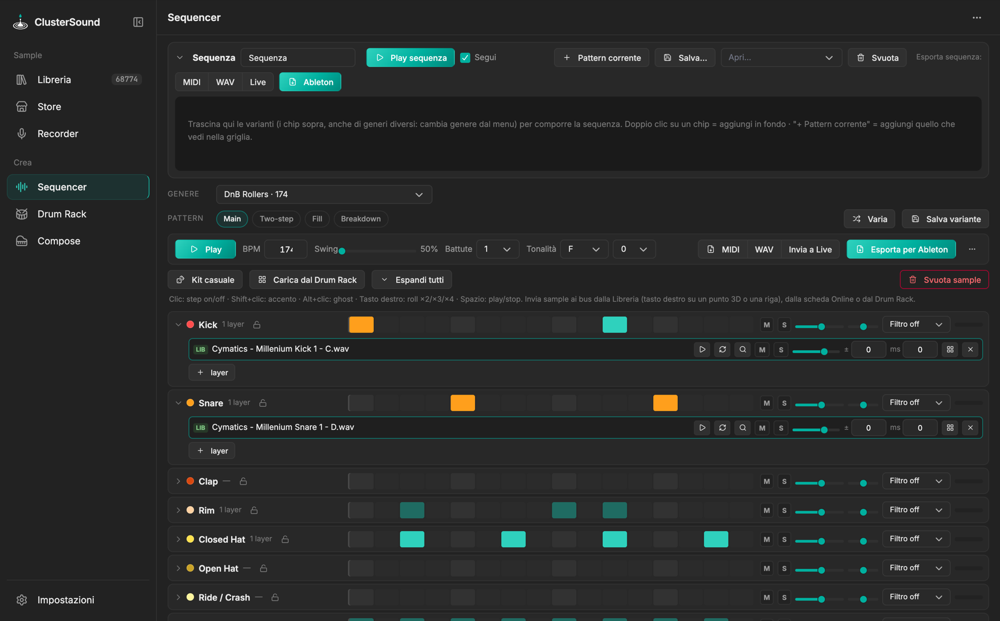

# Sequencer

Un sequencer per **provare i sample su groove tipici** e portarli in Ableton.

{ .shot }

## Generi e pattern

**47 generi, 191 pattern**, con la bass music in primo piano:

- *Bass music UK*: UK garage 2-step, speed garage, bassline, UK funky, grime, dubstep, riddim, tearout, halftime,
  breaks, future garage;
- *Drum & bass / jungle*: liquid, rollers, jump-up, neurofunk, dancefloor, jungle (amen), minimal, drumfunk,
  footwork;
- *Hip hop / trap*: boom bap, lo-fi, trap, UK e NY drill, phonk, memphis, jersey club, baltimore club;
- *House / techno*: house, deep, tech house, techno, minimal, electro, trance, hardstyle, disco;
- *Global*: afrobeats, amapiano, reggaeton/dembow, dancehall, moombahton, pop, funk, rock, breakbeat.

Ogni genere ha le sue varianti più *Fill* e *Breakdown* generate automaticamente, con BPM, swing e tonalità del
genere. **Varia** crea una variazione del groove; **Salva variante** la aggiunge alle tue (★).

## Bus, step e layer

- **Bus**: Kick, Snare, Clap, Rim, Closed Hat, Open Hat, Ride/Crash, Perc, Tom, FX e Bass, ognuno con step,
  volume, pan, filtro, mute/solo e meter. 🔒 blocca il bus rispetto al kit casuale.
- **Step**: clic accende/spegne, `Shift`+clic accento, `Alt`+clic ghost note, tasto destro roll ×2/×3/×4. Hi-hat
  chiuso e aperto sono in choke.
- **Layer**: ogni bus può avere più sample insieme (es. 3 snare), ciascuno con volume, pitch, offset in ms,
  mute/solo ed eventualmente step propri.
- **Alternanza dei layer** (con 2+ layer): *insieme* (tutti a ogni colpo), *a giro* (uno dopo l'altro), *casuale*
  (uno a caso per colpo, uguale a ogni giro; ⚄ rifà l'estrazione), *casuale ogni giro* (nuova estrazione a ogni
  ripetizione). L'export registra esattamente ciò che senti.
- **Basso**: piano-roll con glide (`Alt`+clic su una nota). La nota radice del sample viene rilevata da sola, così
  il basso suona intonato.

## Caricare i sample

- **Invia** dalla Libreria (tasto destro su un punto o una riga, o *Invia ▾* nella tendina) e dallo Store (→):
  come nuovo layer o al posto di quello selezionato.
- **🎲 Kit casuale**: per ogni bus che suona sceglie un gruppo di sample simili (classe + sottocluster) e ne prende
  1, 2 o 4 (alternati a caso). Si può limitare a una cartella o pack, tenere solo i one-shot e far combaciare le
  dinamiche. Il groove resta lo stesso.
- **▦ Carica dal Drum Rack**: porta i sample del Drum Rack nei bus della loro classe.
- I sample online restano nella **cache temporanea** (300 MB, configurabile) e diventano file solo all'export.

## Sequenza (arrangiamento)

Nel pannello *Sequenza* componi una scaletta di pattern, anche di generi diversi:

- trascina un chip di variante (o doppio clic), oppure *+ Pattern corrente*;
- le card si riordinano trascinandole e hanno ×N ripetizioni, duplica, rinomina, elimina; sono larghe in
  proporzione alle battute e mostrano la miniatura del groove;
- clic su una card: la griglia modifica quel blocco; *Play sequenza* con *Segui* mostra il blocco che suona;
- kit e BPM sono condivisi, lo swing resta quello di ogni blocco;
- *Salva…* / *Apri…* gestiscono le sequenze salvate (con il kit).

## Esportare

- **MIDI**: mappatura Drum Rack (pad consecutivi da C1) o General MIDI.
- **WAV** del loop o della sequenza.
- **Esporta per Ableton**: una cartella con `Samples/<Bus>/…wav` (più `.license.txt` per i sample online),
  `… Drum Rack.adg` (un pad per bus, Instrument Rack annidato quando il bus ha più layer), `… Bass.adg` (Simpler
  mono con nota radice e glide), `Drums.mid`, `Bass.mid`, `Loop.wav` e `LEGGIMI.txt`.
- **Invia a Live**: lo stesso, importato direttamente dal device. Verificato con Live 10.1.

Come funzionano swing, roll, alternanza, Fill e rendering: [Algoritmi › Sequencer](../algoritmi/sequencer.md).
