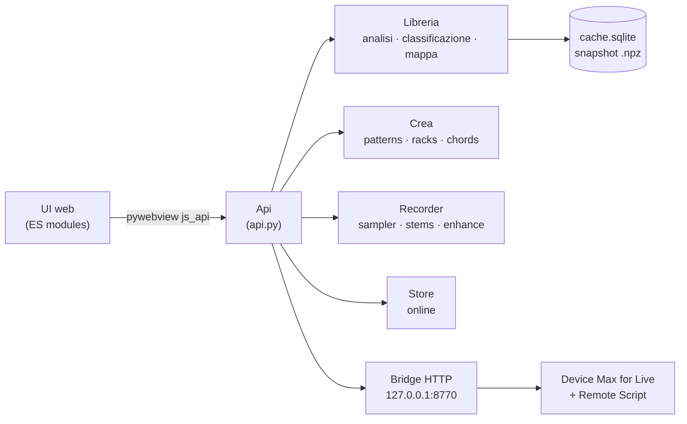

# Architettura

ClusterSound è un'app desktop **Python + WebView**: tutta la logica (analisi audio, classificazione, generazione
musicale, export) è in Python; l'interfaccia è una pagina web locale che chiama Python attraverso il ponte JS di
pywebview. Non c'è un server web tra i due e non c'è rete, salvo lo Store e i download dei modelli.

## Avvio

1. `python -m clustersound` → `__main__.main()` legge gli argomenti: `--headless DIR [--out report]` analizza senza
   finestra, `--enhance-worker` trasforma il processo in un worker di Apollo (vedi sotto), `--debug` apre
   l'inspector.
2. `app.run()` crea un'istanza di `Api`, apre la finestra (`ui/index.html`, 1480×920, minimo 1000×640) passando
   l'`Api` come `js_api`, collega il drag & drop dal Finder e avvia il **bridge per Live** su `127.0.0.1:8770`.
3. Nella pagina, `app.js` attende l'evento `pywebviewready`, chiama `api.init()` e costruisce i moduli di ogni
   sezione; se c'è un'ultima cartella, la ripristina dallo snapshot (`api.restore`).

## Comunicazione UI ↔ Python

- **Chiamate**: ogni metodo pubblico di `Api` è disponibile in JS come `await window.pywebview.api.metodo(...)`.
  Argomenti e risultati viaggiano in JSON. I metodi interni iniziano con `_`, perché pywebview espone ogni
  attributo pubblico.
- **Lavori lunghi**: scansione, riaddestramento, stem, restauro, download girano in **thread daemon** (o in un
  processo separato) e aggiornano un dizionario di stato. La UI fa **polling** (`progress()`, `stems_status()`,
  `enhance_status()`, `downloads()`…): ogni 400 ms durante una scansione, 1,2 s a riposo. Un contatore `version`
  dice alla UI quando ricaricare i risultati.
- **Push**: l'unico caso in cui Python chiama JS è il drop di un file dal Finder sul Recorder
  (`window.evaluate_js`).
- **Audio verso la UI**: anteprime e sample arrivano come *data URL* base64 (WAV, al massimo 60 s), decodificati da
  Web Audio. Nessun file server locale.

## Processi

| Processo | Quando | Perché |
|---|---|---|
| App (Python + WebView) | sempre | UI, API, analisi, generazione |
| Worker Apollo (`--enhance-worker`) | durante *Migliora* | carica PyTorch e il modello solo per il tempo del lavoro, poi restituisce tutta la memoria |
| `cs-tap` (Swift) | durante una registrazione su macOS 14.2+ | legge l'uscita audio con i Core Audio process tap; un processo per uscita |
| Live + device + Remote Script | se usi Ableton | importano i contenuti tramite il bridge HTTP |

Demucs gira invece nel processo dell'app (in un thread), ma importa PyTorch solo quando parte una separazione.

## Principi

- **Locale e privato**: l'audio non lascia mai il computer; i modelli girano in locale; il bridge ascolta solo su
  `127.0.0.1`.
- **Non distruttivo**: i file della libreria non vengono mai modificati; tutto ciò che l'app produce va nelle sue
  cartelle.
- **Leggero di default**: niente TensorFlow né onnxruntime; YAMNet gira in numpy con pesi float16 da 6,9 MB.
  PyTorch è un extra.
- **Una sola fonte di verità**: la tassonomia sta in `taxonomy.py`; gli eventi musicali (accordi, pattern) sono
  calcolati in Python e usati identici per anteprima, MIDI e Live; l'hash dell'alternanza dei layer è identico in
  Python e JS.
