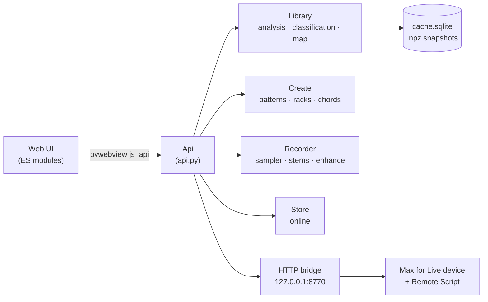

# Architecture

ClusterSound is a **Python + WebView** desktop app: all the logic (audio analysis, classification, music
generation, export) is in Python; the interface is a local web page that calls Python through pywebview's JS
bridge. There is no web server between the two and no network, except for the Store and the model downloads.

## Startup

1. `python -m clustersound` → `__main__.main()` reads the arguments: `--headless DIR [--out report]` analyses without
   a window, `--enhance-worker` turns the process into an Apollo worker (see below), `--debug` opens the
   inspector.
2. `app.run()` creates an `Api` instance, opens the window (`ui/index.html`, 1480×920, minimum 1000×640) passing the
   `Api` as `js_api`, hooks up drag & drop from the Finder and starts the **Live bridge** on `127.0.0.1:8770`.
3. In the page, `app.js` waits for the `pywebviewready` event, calls `api.init()` (which also returns the interface
   language), applies the language and builds the modules of every section; if there is a last folder, it restores
   it from the snapshot (`api.restore`).

## UI ↔ Python communication

- **Calls**: every public method of `Api` is available in JS as `await window.pywebview.api.method(...)`.
  Arguments and results travel as JSON. Internal methods start with `_`, because pywebview exposes every public
  attribute.
- **Long jobs**: scan, retraining, stems, restoration, downloads run in **daemon threads** (or in a separate
  process) and update a state dictionary. The UI **polls** (`progress()`, `stems_status()`, `enhance_status()`,
  `downloads()`…): every 400 ms during a scan, 1.2 s at rest. A `version` counter tells the UI when to reload the
  results.
- **Push**: the only case where Python calls JS is the drop of a file from the Finder onto the Recorder
  (`window.evaluate_js`).
- **Audio to the UI**: previews and samples arrive as base64 *data URLs* (WAV, at most 60 s), decoded by Web Audio.
  No local file server.

## Processes

| Process | When | Why |
|---|---|---|
| App (Python + WebView) | always | UI, API, analysis, generation |
| Apollo worker (`--enhance-worker`) | during *Enhance* | loads PyTorch and the model only for the duration of the job, then gives all the memory back |
| `cs-tap` (Swift) | during a recording on macOS 14.2+ | reads the audio output with Core Audio process taps; one process per output |
| Live + device + Remote Script | if you use Ableton | import the content through the HTTP bridge |

Demucs runs inside the app process instead (in a thread), but imports PyTorch only when a separation starts.

## Principles

- **Local and private**: the audio never leaves the computer; the models run locally; the bridge only listens on
  `127.0.0.1`.
- **Non-destructive**: the library files are never modified; everything the app produces goes into its own
  folders.
- **Light by default**: no TensorFlow or onnxruntime; YAMNet runs in numpy with 6.9 MB float16 weights.
  PyTorch is an extra.
- **A single source of truth**: the taxonomy lives in `taxonomy.py`; musical events (chords, patterns) are
  computed in Python and used identically for preview, MIDI and Live; the layer alternation hash is identical in
  Python and JS; the Italian translations live in one catalogue used by both sides.
