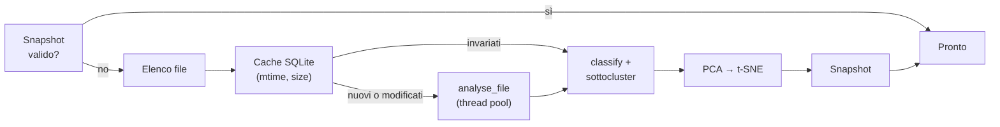

# Backend

Il backend è il package `clustersound/`. Ogni area funzionale è un sotto-package indipendente dalla UI; `api.py`
li compone e li espone alla WebView.

```
clustersound/
├── __main__.py, app.py      avvio, CLI headless, finestra pywebview
├── api.py                   Api: 114 metodi pubblici chiamati dalla UI
├── paths.py                 cartelle di dati/cache, risorse nel bundle, scelta del device torch
├── audio_io.py              decodifica (libsndfile), mono, trim, resampling (soxr)
├── frontend.py              log-mel di YAMNet in numpy
├── yamnet_np.py, embedder.py  rete YAMNet in numpy, embedding e score
├── features.py              22 feature acustiche, profilo mel, onset, tipo, regole
├── taxonomy.py              34 classi: colori, keyword, mappa AudioSet
├── classifier.py            fusione dei segnali, head MLP (training e inferenza)
├── clustering.py            k-means + silhouette, kNN
├── projection.py            PCA, t-SNE 3D, landmark
├── library.py               scansione, cache, classificazione, sottocluster, layout
├── cache.py, snapshot.py    SQLite delle analisi, snapshot per cartella
├── dynamics.py              misure della tendina (ADSR, T60, forma d'onda, spettrogramma)
├── export.py                report CSV/JSON
├── online/                  Store: provider, ricerca federata, licenze, cache, download
├── patterns/                Sequencer: generi, modello, rendering, MIDI, arrangiamento, export Live
├── racks/                   Drum Rack: selezione, layout 8×8 e SPD-SX, dynamics match, export
├── chords/                  Compose: libreria del pack, teoria, armonia, variazioni, esecuzione, melodia
├── sampler/                 Recorder: sessione, slicing, export, registrazione, stem, link
├── enhance/                 Migliora: rete Apollo, worker, runner, download dei modelli
├── live/                    bridge HTTP per Max for Live e payload
├── native/cs_tap.swift      helper di registrazione macOS
├── models/                  yamnet.npz, base_head.npz, yamnet_class_map.csv
└── ui/                      interfaccia web
```

## Api

`Api` (`api.py`) è l'unico punto d'ingresso per la UI. È una facciata sottile: valida gli argomenti, chiama i
moduli e restituisce JSON. I metodi per area:

| Area | N. | Esempi |
|---|---|---|
| Libreria | 12 | `init`, `start_scan`, `restore`, `progress`, `results`, `details`, `audio`, `similar`, `relabel`, `export_report` |
| Impostazioni | 3 | `get_settings`, `set_setting` (whitelist di chiavi), `clear_cache` |
| Store | 14 | `online_search`, `online_more`, `online_packs`, `online_pack`, `online_expand`, `online_preview`, `online_download` |
| Recorder | 26 | `sampler_open_file`, `sampler_auto_slices`, `sampler_export`, `recorder_start/stop/status`, `stems_*`, `enhance_*` |
| Sequencer | 19 | `patterns_init`, `pattern_build`, `pattern_candidates`, `dynamic_suggestions`, `sequence_flatten`, `export_midi/wav/ableton` |
| Compose | 21 | `compose_chords`, `compose_suggest`, `compose_render`, `compose_vary_*`, `compose_melody_generate`, `compose_harmonize` |
| Drum Rack | 14 | `rack_fill`, `rack_trail_fill`, `rack_candidates`, `rack_autofill`, `rack_randomize`, `rack_generate`, `rack_check`, `export_rack` |
| Live | 5 | `live_start`, `live_status`, `live_set_kit`, `live_send`, `sampler_send_to_live` |

**Concorrenza.** pywebview esegue le chiamate JS → Python su più thread, quindi `Api` protegge lo stato condiviso
con lock dedicati (`_rack_lock`, `_relabel_lock`, `_stems_lock`, `_enh_lock`). I lavori lunghi partono in
`threading.Thread(daemon=True)` e scrivono il loro stato in un dizionario (`state`, `progress`, `error`) letto dai
metodi `*_status`; l'annullamento passa da un `threading.Event`. Un `threading.Timer` di 3 s raggruppa i download
finiti prima di riscansionare la libreria.

**Audio.** `audio(id)`, `online_preview`, `sample_audio`… restituiscono data URL WAV in base64: la UI non ha
accesso al file system e la WebView non deve servire file locali.

## Libreria (`library.py`)

`Library` possiede gli item analizzati e lo stato della scansione. `start_scan(root)` lancia `scan()` in un thread
(annullando quella precedente) che attraversa le fasi **scanning → analysing → classifying → layout → done**:



- **Analisi** (`analyse_file`): decodifica i primi 30 s, toglie il silenzio, ricampiona a 16 kHz (YAMNet) e 32 kHz
  (feature), calcola embedding, score, profilo e feature. Gira in un `ThreadPoolExecutor` con `max(2, cpu)`
  worker: numpy e libsndfile rilasciano il GIL.
- **Classificazione** e **sottocluster** per classe, poi **layout**: una PCA immediata, poi la t-SNE.
- `version` cresce a ogni cambiamento; `relabel` salva l'etichetta e riclassifica in background.

Dettagli: [Analisi audio](../algorithms/audio-analysis.md), [Classificatore](../ai/classifier.md),
[Clustering e mappa](../algorithms/clustering-and-map.md).

## Store (`online/`)

Un modulo per provider (`freesound.py`, `openverse.py`, `archive.py`, `ccmixter.py`) con la stessa interfaccia
(`search`, `packs`, `expand`…) e un elenco `SERVER_FILTERS`. `search.py` li interroga in parallelo e uniforma i
risultati; `instruments.py` li etichetta con le classi della tassonomia; `base.py` fa HTTP con cache in memoria e
normalizza le licenze; `cache.py` tiene le anteprime audio con un limite di spazio; `downloads.py` scarica con il
file di licenza; `catalog.py` contiene provider e vetrina. Vedi [Algoritmi › Store](../algorithms/store.md).

## Sequencer (`patterns/`)

| Modulo | Ruolo |
|---|---|
| `genres.py` | 47 generi (BPM, swing, tonalità, varianti) e derivazione di Fill/Breakdown |
| `model.py` | formato del pattern: step, velocity, roll, swing, basso, alternanza dei layer |
| `render.py` | mix offline in numpy (WAV del loop, choke, filtri, intonazione del basso) |
| `midi.py` | scrittura/lettura SMF senza dipendenze, mappature Drum Rack e GM |
| `arrange.py` | appiattisce una sequenza di blocchi in un unico pattern |
| `ableton.py` | `.adg` (Drum Rack, Instrument Rack, Simpler) da template XML di Live 10 |
| `store.py` | pattern e sequenze utente in `patterns.json` |

Vedi [Algoritmi › Sequencer](../algorithms/sequencer.md).

## Drum Rack (`racks/`)

`select.py` (vicini, scelta casuale pesata, percorso, gruppo casuale), `layouts.py` (geometrie e note 8×8),
`spdsx.py` (configurazioni, trigger e limiti di suonabilità), `dynamics_match.py` (somiglianza d'inviluppo),
`ableton.py` / `spdsx_export.py` (export), `store.py` (`racks.json`). Le maschere dei candidati (classe, famiglia,
one-shot, cartella) e l'auto-riempimento sono in `api.py`. Vedi
[Algoritmi › Drum Rack](../algorithms/drum-rack.md).

## Compose (`chords/`)

| Modulo | Ruolo |
|---|---|
| `library.py` | indicizza il chord pack (cartelle per tonalità, segmentazione delle clip, bigrammi) |
| `theory.py` | qualità, radice, gradi, funzioni armoniche |
| `harmony.py` | punteggio delle transizioni e suggerimenti del prossimo accordo |
| `variations.py` | variazioni di accordo, progressione e modalità di esecuzione |
| `perform.py` | dagli accordi alle note: strum, arpeggio, ritmo, dinamica, humanize (PPQ 480) |
| `melody.py` | generatori di linee, armonizzazione, rilevamento della tonalità |
| `midi_in.py` | registrazione da tastiera MIDI (python-rtmidi) |
| `export.py` | MIDI tipo 0/1 per versioni e layer |

Vedi [Armonia](../algorithms/harmony.md) e [Melodia](../algorithms/melody.md).

## Recorder (`sampler/`, `enhance/`)

- `session.py`: l'audio aperto (float32, ≤ 2 canali, al massimo 20 minuti) e i picchi per la forma d'onda.
- `slicing.py`: regioni sui transienti e rendering dei sample con fade.
- `recorder.py`: registrazione multi-uscita con backend `cs-tap` (macOS 14.2+), ScreenCaptureKit (`capture.py`) o
  WASAPI (`wasapi.py`); `Writer` scrive in streaming in tutti i formati.
- `stems.py`: Demucs nel processo, a blocchi. `enhance/`: Apollo in un processo separato.
- `links.py`: apre link di Freesound, Internet Archive, ccMixter, Openverse e Wikimedia (rifiuta lo streaming).
- `export.py`: WAV 24 bit con nota di licenza o provenienza.

Vedi [Recorder e slicing](../algorithms/recorder-and-slicing.md), [Demucs](../ai/demucs.md), [Apollo](../ai/apollo.md).

## Live (`live/`)

`server.py` è il bridge HTTP; `payload.py` traduce pattern, sequenze, rack e progressioni in un payload unico
(tracce, rack `.adg`, clip con note). Vedi [Integrazione con Live](live-integration.md).
