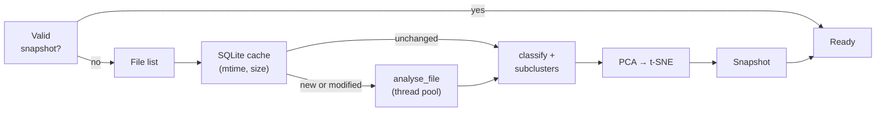

# Backend

The backend is the `clustersound/` package. Every functional area is a sub-package independent of the UI; `api.py`
puts them together and exposes them to the WebView.

```
clustersound/
├── __main__.py, app.py      startup, headless CLI, pywebview window
├── api.py                   Api: the public methods called by the UI
├── i18n.py                  interface language: tr(), N_(), localize()
├── paths.py                 data/cache folders, resources in the bundle, choice of the torch device
├── audio_io.py              decoding (libsndfile), mono, trim, resampling (soxr)
├── frontend.py              YAMNet log-mel in numpy
├── yamnet_np.py, embedder.py  YAMNet network in numpy, embeddings and scores
├── features.py              22 acoustic features, mel profile, onsets, type, rules
├── taxonomy.py              34 classes: colours, keywords, AudioSet map
├── classifier.py            signal fusion, MLP head (training and inference)
├── clustering.py            k-means + silhouette, kNN
├── projection.py            PCA, 3D t-SNE, landmarks
├── library.py               scan, cache, classification, subclusters, layout
├── cache.py, snapshot.py    SQLite of the analyses, snapshot per folder
├── dynamics.py              measures of the drawer (ADSR, T60, waveform, spectrogram)
├── export.py                CSV/JSON report
├── online/                  Store: providers, federated search, licences, cache, downloads
├── patterns/                Sequencer: genres, model, rendering, MIDI, arrangement, Live export
├── racks/                   Drum Rack: selection, 8×8 and SPD-SX layouts, dynamics match, export
├── chords/                  Compose: pack library, theory, harmony, variations, playing, melody
├── sampler/                 Recorder: session, slicing, export, recording, stems, links
├── enhance/                 Enhance: Apollo network, worker, runner, model downloads
├── live/                    HTTP bridge for Max for Live and payloads
├── native/cs_tap.swift      macOS recording helper
├── models/                  yamnet.npz, base_head.npz, yamnet_class_map.csv
└── ui/                      web interface (ui/locales/it.js: Italian catalogue)
```

## Api

`Api` (`api.py`) is the only entry point for the UI. It is a thin façade: it validates the arguments, calls the
modules and returns JSON. The methods by area:

| Area | N. | Examples |
|---|---|---|
| Library | 12 | `init`, `start_scan`, `restore`, `progress`, `results`, `details`, `audio`, `similar`, `relabel`, `export_report` |
| Settings | 3 | `get_settings`, `set_setting` (whitelist of keys, including `language`), `clear_cache` |
| Store | 14 | `online_search`, `online_more`, `online_packs`, `online_pack`, `online_expand`, `online_preview`, `online_download` |
| Recorder | 26 | `sampler_open_file`, `sampler_auto_slices`, `sampler_export`, `recorder_start/stop/status`, `stems_*`, `enhance_*` |
| Sequencer | 19 | `patterns_init`, `pattern_build`, `pattern_candidates`, `dynamic_suggestions`, `sequence_flatten`, `export_midi/wav/ableton` |
| Compose | 21 | `compose_chords`, `compose_suggest`, `compose_render`, `compose_vary_*`, `compose_melody_generate`, `compose_harmonize` |
| Drum Rack | 14 | `rack_fill`, `rack_trail_fill`, `rack_candidates`, `rack_autofill`, `rack_randomize`, `rack_generate`, `rack_check`, `export_rack` |
| Live | 5 | `live_start`, `live_status`, `live_set_kit`, `live_send`, `sampler_send_to_live` |

**Concurrency.** pywebview runs JS → Python calls on several threads, so `Api` protects the shared state with
dedicated locks (`_rack_lock`, `_relabel_lock`, `_stems_lock`, `_enh_lock`). Long jobs start in
`threading.Thread(daemon=True)` and write their state into a dictionary (`state`, `progress`, `error`) read by the
`*_status` methods; cancellation goes through a `threading.Event`. A 3 s `threading.Timer` groups finished
downloads before rescanning the library.

**Audio.** `audio(id)`, `online_preview`, `sample_audio`… return base64 WAV data URLs: the UI has no access to the
file system and the WebView does not have to serve local files.

**Language.** `i18n.py` keeps the interface language (`en` by default, `it`), set from `settings.json` at startup
and by `set_setting('language', …)`. Every message that reaches the UI (errors, progress, labels, export READMEs)
is written in English and goes through `tr("…")`; module constants are marked with `N_("…")` and translated
where they reach the UI, often with `localize()`, which translates the labels of a structure and leaves the ids
alone. Details in [Frontend › Translations](frontend.md#translations).

## Library (`library.py`)

`Library` owns the analysed items and the state of the scan. `start_scan(root)` launches `scan()` in a thread
(cancelling the previous one) that goes through the phases **scanning → analysing → classifying → layout → done**:



- **Analysis** (`analyse_file`): decodes the first 30 s, removes silence, resamples to 16 kHz (YAMNet) and 32 kHz
  (features), computes embedding, scores, profile and features. It runs in a `ThreadPoolExecutor` with `max(2, cpu)`
  workers: numpy and libsndfile release the GIL.
- **Classification** and **subclusters** per class, then **layout**: an immediate PCA, then the t-SNE.
- `version` grows on every change; `relabel` saves the label and reclassifies in the background.

Details: [Audio analysis](../algorithms/audio-analysis.md), [Classifier](../ai/classifier.md),
[Clustering and map](../algorithms/clustering-and-map.md).

## Store (`online/`)

One module per provider (`freesound.py`, `openverse.py`, `archive.py`, `ccmixter.py`) with the same interface
(`search`, `packs`, `expand`…) and a `SERVER_FILTERS` list. `search.py` queries them in parallel and normalises the
results; `instruments.py` labels them with the taxonomy classes; `base.py` does HTTP with an in-memory cache and
normalises the licences; `cache.py` keeps the audio previews within a space limit; `downloads.py` downloads with the
licence file; `catalog.py` holds providers and showcase. See [Algorithms › Store](../algorithms/store.md).

## Sequencer (`patterns/`)

| Module | Role |
|---|---|
| `genres.py` | 47 genres (BPM, swing, key, variants) and derivation of Fill/Breakdown |
| `model.py` | pattern format: steps, velocity, rolls, swing, bass, layer alternation |
| `render.py` | offline mix in numpy (loop WAV, choke, filters, bass tuning) |
| `midi.py` | dependency-free SMF writing/reading, Drum Rack and GM mappings |
| `arrange.py` | flattens a sequence of blocks into a single pattern |
| `ableton.py` | `.adg` (Drum Rack, Instrument Rack, Simpler) from Live 10 XML templates |
| `store.py` | user patterns and sequences in `patterns.json` |

See [Algorithms › Sequencer](../algorithms/sequencer.md).

## Drum Rack (`racks/`)

`select.py` (neighbours, weighted random choice, trail, random group), `layouts.py` (8×8 layouts and notes),
`spdsx.py` (configurations, triggers and playability limits), `dynamics_match.py` (envelope similarity),
`ableton.py` / `spdsx_export.py` (export), `store.py` (`racks.json`). The candidate masks (class, family,
one-shot, folder) and auto-fill are in `api.py`. See [Algorithms › Drum Rack](../algorithms/drum-rack.md).

## Compose (`chords/`)

| Module | Role |
|---|---|
| `library.py` | indexes the chord pack (folders per key, clip segmentation, bigrams) |
| `theory.py` | quality, root, degrees, harmonic functions |
| `harmony.py` | transition scores and next-chord suggestions |
| `variations.py` | variations of a chord, a progression and a playing mode |
| `perform.py` | from chords to notes: strum, arpeggio, rhythm, dynamics, humanize (PPQ 480) |
| `melody.py` | line generators, harmonisation, key detection |
| `midi_in.py` | recording from a MIDI keyboard (python-rtmidi) |
| `export.py` | type 0/1 MIDI for versions and layers |

See [Harmony](../algorithms/harmony.md) and [Melody](../algorithms/melody.md).

## Recorder (`sampler/`, `enhance/`)

- `session.py`: the open audio (float32, ≤ 2 channels, at most 20 minutes) and the peaks for the waveform.
- `slicing.py`: regions on transients and rendering of the samples with fades.
- `recorder.py`: multi-output recording with a `cs-tap` (macOS 14.2+), ScreenCaptureKit (`capture.py`) or WASAPI
  (`wasapi.py`) backend; `Writer` streams to every format.
- `stems.py`: Demucs in the process, in blocks. `enhance/`: Apollo in a separate process.
- `links.py`: opens Freesound, Internet Archive, ccMixter, Openverse and Wikimedia links (refuses streaming).
- `export.py`: 24-bit WAV with a licence or provenance note.

See [Recorder and slicing](../algorithms/recorder-and-slicing.md), [Demucs](../ai/demucs.md), [Apollo](../ai/apollo.md).

## Live (`live/`)

`server.py` is the HTTP bridge; `payload.py` turns patterns, sequences, racks and progressions into a single
payload (tracks, `.adg` racks, clips with notes). See [Live integration](live-integration.md).
