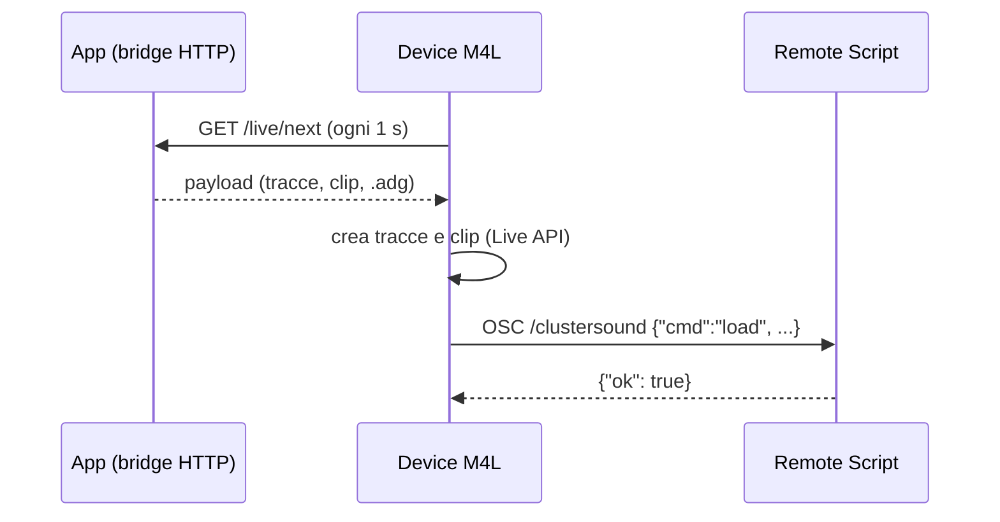

# Integrazione con Live

L'integrazione con Ableton Live ha tre pezzi, ognuno con un compito che gli altri non possono svolgere:

| Pezzo | Dove gira | Compito |
|---|---|---|
| **Bridge HTTP** (`live/server.py`) | nell'app, `127.0.0.1:8770` | espone catalogo e contenuti pronti per Live, e una coda di invii |
| **Device** (`m4l/ClusterSound.maxpat` + `ClusterSound.js`) | Max for Live, in una traccia MIDI | crea tracce e clip con le note tramite la Live API |
| **Remote Script** (`remote_script/ClusterSoundBridge`) | dentro Live (Python 2.7 in Live 10) | carica preset `.adg` e strumenti del browser di Live, cosa che la Live API di Max non può fare |



## Bridge HTTP

Un `ThreadingHTTPServer` in un thread daemon, legato solo a `127.0.0.1` (porta in Impostazioni › Generale). Solo
queste rotte, nessun RPC generico:

| Rotta | Risposta |
|---|---|
| `GET /live/ping` | `{"app", "version", "pending"}` |
| `GET /live/catalog` | pattern, sequenze, rack e progressioni salvati |
| `GET /live/payload?kind=pattern\|sequence\|rack\|compose&id=…` | il payload di un elemento salvato |
| `GET /live/next` | il più vecchio elemento inviato con *Invia a Live*, o `204` |
| `GET /live/clip?data=<json>` / `POST /live/clip` | la clip selezionata in Live, per l'import della melodia |

Il device usa solo `GET` perché l'`XMLHttpRequest` di Max è affidabile solo con quello.

## Payload

`live/payload.py` traduce ogni contenuto in una forma unica:

```json
{
  "kind": "pattern", "name": "DnB Rollers", "bpm": 174, "folder": "…",
  "tracks": [
    {"name": "Drums", "role": "drums",
     "adg": "/…/User Library/ClusterSound/…/Drum Rack.adg",
     "adg_root": "user_library", "adg_path": "ClusterSound/…/Drum Rack.adg",
     "clips": [{"name": "Main", "length": 4, "notes": [[36, 0.0, 0.125, 127], …]}]}
  ]
}
```

- I tempi sono in **beat** (semiminime), come vuole la Live API delle clip.
- I preset sono scritti dagli stessi exporter Ableton dell'app in una *stage*: per default la cartella
  `ClusterSound` della User Library, che Live indicizza sempre, così la Remote Script li trova per `adg_path` sotto
  `browser.user_library`. Senza User Library la stage è una cartella da aggiungere ai *Places*.
- Una traccia **audio** (Recorder) non ha clip MIDI ma un `audio_file` WAV: in Live 12 il device crea la clip con
  `ClipSlot.create_audio_clip`, nelle versioni precedenti la carica la Remote Script.

## Device

JavaScript ES5 (motore `js` di Max 8). Un `Task` interroga `/live/next` ogni secondo quando *Ricevi* è attivo;
`importPayload` crea le tracce dopo quella selezionata (o usa quella selezionata), imposta il tempo, crea le clip
nella scena selezionata e sempre in uno slot vuoto, poi chiede alla Remote Script di caricare il rack. La colonna
*Suoni* chiede alla Remote Script le categorie e i preset del browser di Live e li carica sulla traccia importata.

## Remote Script

Una Control Surface senza input/output MIDI. Apre un socket UDP non bloccante e lo legge in `update_display`
(~ogni 100 ms, il tick della superficie). I messaggi sono OSC con indirizzo `/clustersound` e un solo argomento
stringa contenente un JSON:

| Direzione | Porta | Esempi |
|---|---|---|
| device → script | 9101 | `{"id": n, "cmd": "ping"}`, `{"cmd": "load", "track": i, "place": "…/x.adg"}`, `categories`, `list`, `load_item`, `load_audio`, `log` |
| script → device | 9102 | `{"id": n, "ok": true, …}` o `{"id": n, "ok": false, "error": "…"}` |

`protocol.py` non importa nulla di Live, quindi è testato con pytest fuori da Live. Ogni comando viene scritto nel
`Log.txt` di Live con il prefisso `ClusterSoundBridge`.
