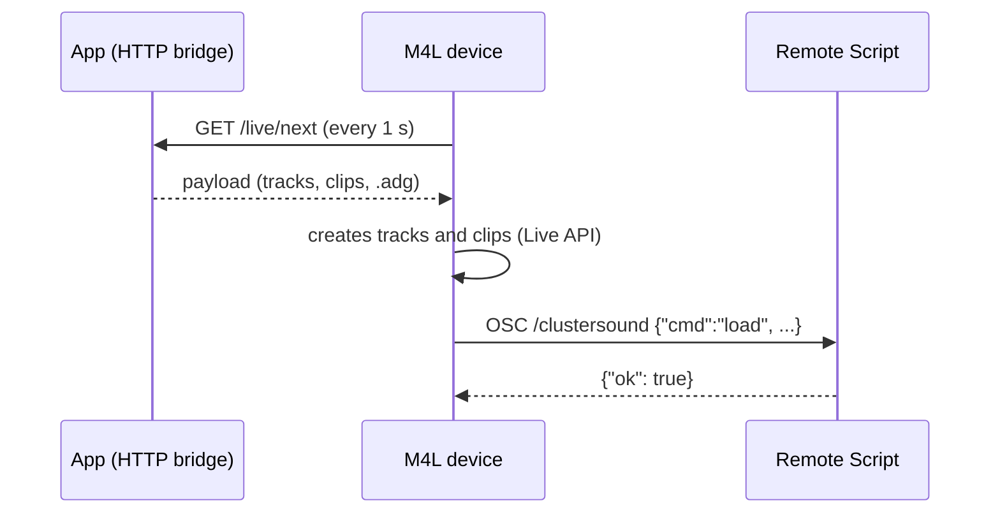

# Live integration

The integration with Ableton Live has three pieces, each with a job the others cannot do:

| Piece | Where it runs | Job |
|---|---|---|
| **HTTP bridge** (`live/server.py`) | in the app, `127.0.0.1:8770` | exposes a catalogue and content ready for Live, and a queue of sends |
| **Device** (`m4l/ClusterSound.maxpat` + `ClusterSound.js`) | Max for Live, on a MIDI track | creates tracks and clips with notes through the Live API |
| **Remote Script** (`remote_script/ClusterSoundBridge`) | inside Live (Python 2.7 in Live 10) | loads `.adg` presets and instruments from Live's browser, which Max's Live API cannot do |



## HTTP bridge

A `ThreadingHTTPServer` in a daemon thread, bound only to `127.0.0.1` (port in Settings › General). Only these
routes, no generic RPC:

| Route | Response |
|---|---|
| `GET /live/ping` | `{"app", "version", "pending"}` |
| `GET /live/catalog` | saved patterns, sequences, racks and progressions |
| `GET /live/payload?kind=pattern\|sequence\|rack\|compose&id=…` | the payload of a saved item |
| `GET /live/next` | the oldest item sent with *Send to Live*, or `204` |
| `GET /live/clip?data=<json>` / `POST /live/clip` | the clip selected in Live, for the melody import |

The device only uses `GET` because Max's `XMLHttpRequest` is only reliable with that.

## Payload

`live/payload.py` turns every content into a single shape:

```json
{
  "kind": "pattern", "name": "DnB Rollers", "bpm": 174, "folder": "…",
  "tracks": [
    {"name": "Drums", "role": "drums",
     "adg": "/…/User Library/ClusterSound/…/Drum Rack.adg",
     "adg_root": "user_library", "adg_path": "ClusterSound/…/Drum Rack.adg",
     "clips": [{"name": "Main", "length": 4, "notes": [[36, 0.0, 0.125, 127], …]}]}
  ]
}
```

- Times are in **beats** (quarter notes), as the clip Live API wants.
- The presets are written by the app's own Ableton exporters into a *stage*: by default the `ClusterSound` folder of
  the User Library, which Live always indexes, so the Remote Script finds them by `adg_path` under
  `browser.user_library`. Without a User Library the stage is a folder to add to the *Places*.
- An **audio** track (Recorder) has no MIDI clips but an `audio_file` WAV: in Live 12 the device creates the clip with
  `ClipSlot.create_audio_clip`, in earlier versions the Remote Script loads it.
- Track names (e.g. *Chords – Progression*) follow the app's interface language.

## Device

ES5 JavaScript (Max 8's `js` engine). A `Task` polls `/live/next` every second when *Receive* is on;
`importPayload` creates the tracks after the selected one (or uses the selected one), sets the tempo, creates the
clips in the selected scene and always in an empty slot, then asks the Remote Script to load the rack. The
*Live instruments* column asks the Remote Script for the categories and presets of Live's browser and loads them
on the imported track. The device and the Remote Script are in English.

## Remote Script

A Control Surface without MIDI input/output. It opens a non-blocking UDP socket and reads it in `update_display`
(~every 100 ms, the surface tick). Messages are OSC with the address `/clustersound` and a single string argument
holding a JSON:

| Direction | Port | Examples |
|---|---|---|
| device → script | 9101 | `{"id": n, "cmd": "ping"}`, `{"cmd": "load", "track": i, "place": "…/x.adg"}`, `categories`, `list`, `load_item`, `load_audio`, `log` |
| script → device | 9102 | `{"id": n, "ok": true, …}` or `{"id": n, "ok": false, "error": "…"}` |

`protocol.py` imports nothing from Live, so it is tested with pytest outside Live. Every command is written to
Live's `Log.txt` with the `ClusterSoundBridge` prefix.
